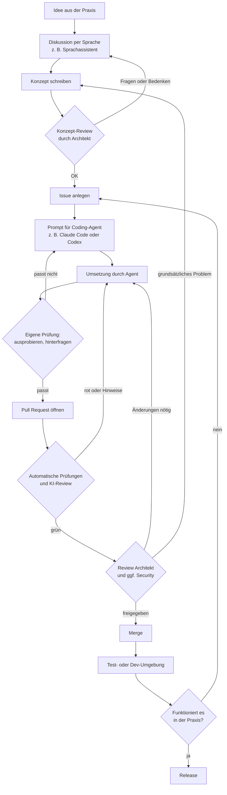

# Modul 01: Rollen und Arbeitsablauf

In [Modul 00](00-warum.md) haben wir gesehen, warum Domänenexperten und IT-Experten zusammenarbeiten müssen: Der eine kennt die Praxis, der andere weiß, wie man Software sicher und wartbar baut, und keiner kann es allein. In diesem Modul wird daraus ein konkreter Zwischenweg: wer im Team welche Aufgabe hat und welchen Weg eine Idee nimmt, bis sie in der Software ankommt. Alle weiteren Module bauen auf diesem Ablauf auf.

## Das Beispiel, das uns durch die Schulung begleitet

Damit es nicht abstrakt bleibt, nutzen wir in allen Modulen dasselbe erfundene Beispiel.

**Die Software:** "Wachbuch" ist eine Web-Anwendung für die (erfundene) Freiwillige Feuerwehr Musterstadt. Man öffnet sie im Browser, auf dem Handy oder am PC im Gerätehaus. Das Wachbuch verwaltet:

- **Mitglieder:** wer ist in der Wehr, welche Qualifikationen hat jemand (z. B. Atemschutzgeräteträger, Maschinist)
- **Dienstzeiten:** Übungen, Einsätze, Lehrgänge und wer daran teilgenommen hat
- **Fahrzeuge:** welche Fahrzeuge es gibt, wann TÜV und Wartung fällig sind
- **Geräteprüfungen:** wann Atemschutzgeräte, Leitern, Schläuche usw. geprüft wurden und wann die nächste Prüfung fällig ist

**Die Personen:**

- **Karl** ist seit 20 Jahren Feuerwehrmann in Musterstadt und Atemschutzgerätewart. Er weiß genau, wie der Alltag in der Wehr läuft, was nervt und was fehlt. Programmieren kann er nicht, aber er nutzt Smartphone, Apps und Cloud-Dienste ganz selbstverständlich. Karl ist unser **Domänenexperte**.
- **Peter** ist Softwarearchitekt. Er hat das Wachbuch technisch aufgesetzt, kennt den Aufbau der Software und entscheidet, was hineinkommt. Peter ist der **Maintainer**, also der Verantwortliche für die Software. Er betreut neben dem Wachbuch noch andere Projekte und hat wenig Zeit: Er liest Konzepte und Pull Requests, gibt Hinweise und schickt Karl damit wieder los.
- **Sabine** kümmert sich um Sicherheit und Datenschutz. Sie ist eine **zusätzliche Rolle**, die nicht jedes Team hat. Fehlt sie, übernimmt Peter ihre Aufgaben und lässt sich dabei von automatischen Prüfwerkzeugen helfen.

**Ein zweites Beispiel** zeigt, dass das Ganze nicht nur für Feuerwehren gilt: Die (erfundene) "Pension Seeblick" hat eine kleine Buchungs-App für ihre acht Zimmer. Dort ist **Anna**, die Inhaberin, die Domänenexpertin. Sie kennt jede Eigenheit von Buchungen, Stornos und Saisonpreisen.

## Die Rollen

### Domänenexperte (z. B. Karl)

Domäne heißt Fachgebiet. Der Domänenexperte kennt das Fachgebiet aus der Praxis.

**Aufgaben:**

- Probleme und Ideen aus dem Alltag erkennen und beschreiben
- Ideen durchdenken, z. B. im Gespräch mit einem Sprachassistenten (Modul 02)
- ein Konzept schreiben und vom Architekten prüfen lassen (Modul 03)
- den Coding-Agenten anleiten und seine Arbeit hinterfragen (Modul 06)
- das Ergebnis selbst ausprobieren: Macht es wirklich, was die Praxis braucht?
- einen Pull Request öffnen und auf Rückmeldungen reagieren (Modul 07)

**Darf nie:**

- etwas ohne Review in die Software bringen
- echte persönliche Daten (z. B. die echte Mitgliederliste) an KI-Werkzeuge geben, wenn das nicht ausdrücklich erlaubt ist
- Passwörter, Zugangsschlüssel oder andere Geheimnisse in Prompts, Issues oder Code schreiben
- Code übernehmen, den er nicht wenigstens in seiner Wirkung verstanden und ausprobiert hat
- Hinweise des Architekten oder der Security einfach übergehen

### Coding-Agent (z. B. Claude Code oder Codex)

Ein Coding-Agent ist ein KI-Werkzeug, das selbstständig Code liest, schreibt, Befehle ausführt und Tests startet. Man gibt ihm einen Auftrag in normaler Sprache (einen Prompt), und er arbeitet ihn Schritt für Schritt ab.

**Aufgaben:**

- den Auftrag und die Regeln des Projekts lesen
- erst einen Plan vorschlagen, dann umsetzen
- Code und Tests schreiben, Prüfungen ausführen
- nachfragen, wenn etwas unklar ist

**Darf nie:**

- selbst entscheiden, was gebaut wird (das entscheidet der Mensch)
- Code ohne Pull Request und Review in die Hauptversion bringen
- Sicherheits- oder Prüfregeln abschalten, damit "es durchläuft"
- raten, wenn eine fachliche Frage offen ist

Wichtig: Der Agent ist schnell und fleißig, aber er kann sich irren und klingt dabei trotzdem überzeugt. Deshalb prüft immer ein Mensch.

### Architekt und Maintainer (z. B. Peter)

Der Architekt ist für den Aufbau der Software als Ganzes verantwortlich. Als Maintainer entscheidet er, was in die Software kommt.

**Aufgaben:**

- Konzepte prüfen, bevor programmiert wird
- Entscheidungen zum Datenmodell und zur Architektur treffen und festhalten (Modul 05)
- Pull Requests prüfen und freigeben (Modul 07)
- Regeln und Standards festlegen (Modul 10)
- Releases und Wartung verantworten (Modul 09)

**Darf nie:**

- etwas freigeben, das er nicht verstanden hat
- Review überspringen, weil es eilig ist
- die Arbeit des Domänenexperten selbst neu schreiben, statt Hinweise zu geben (sonst wird er zum Flaschenhals)

### Security-Verantwortliche (z. B. Sabine, optional)

Sie achtet darauf, dass die Software sicher ist und persönliche Daten geschützt bleiben.

**Aufgaben:**

- Änderungen mit Sicherheitsbezug prüfen: Anmeldung, Rechte, persönliche Daten, Schnittstellen nach außen
- Datenschutzfragen beantworten, besonders bei sensiblen Daten wie Gesundheitsdaten
- Ergebnisse automatischer Sicherheitsprüfungen bewerten

**Darf nie:**

- Sicherheitslücken "später" beheben lassen, wenn sie schon jetzt Schaden anrichten können
- Ausnahmen genehmigen, ohne sie zu dokumentieren

Gibt es keine eigene Security-Person, übernimmt der Architekt diese Prüfung. Automatische Werkzeuge (Modul 08) helfen ihm dabei, ersetzen aber nicht das Nachdenken.

### Automatischer Reviewer (z. B. ein KI-Review-Bot)

Ein KI-Review-Bot liest jeden Pull Request und schreibt Kommentare: mögliche Fehler, unklare Stellen, fehlende Tests.

**Aufgaben:**

- früh und schnell Auffälligkeiten melden, bevor ein Mensch Zeit investiert

**Darf nie:**

- allein über eine Freigabe entscheiden. Seine Kommentare sind Hinweise, keine Urteile.

### CI (automatische Prüfungen)

CI steht für "Continuous Integration", auf Deutsch etwa "laufendes Zusammenführen". Gemeint ist: Bei jeder Änderung laufen automatisch Prüfungen, z. B. Tests, Formatierung, Sicherheits-Scans.

**Aufgaben:**

- jede Änderung nach festen Regeln prüfen
- rot (Fehler) oder grün (alles in Ordnung) melden

**Darf nie:**

- abgeschaltet oder umgangen werden, damit ein Pull Request schneller durchkommt

## Der Arbeitsablauf

So kommt eine Idee in die Software. Die Rauten sind Prüfpunkte: Wenn dort etwas nicht passt, geht es zurück.

### Die Schritte kurz erklärt

1. **Idee:** Karl merkt bei der Übung, dass die Atemschutz-Nachweise doppelt gepflegt werden. Das ist die Idee.
2. **Diskussion per Sprache:** Auf der Heimfahrt bespricht er die Idee mit einem Sprachassistenten. Der stellt Rückfragen und zeigt Lücken auf (Modul 02).
3. **Konzept:** Zu Hause macht Karl daraus ein kurzes Konzept nach Vorlage (Modul 03). Vorher schaut er, wie andere das Problem lösen (Modul 04).
4. **Konzept-Review:** Peter liest das Konzept. Hier ist ein Fehler am billigsten zu beheben, denn es ist noch keine Zeile Code geschrieben.
5. **Issue:** Das Konzept wird zu einem Issue. Ein Issue ist ein Eintrag in der Aufgabenliste des Projekts (z. B. auf GitHub).
6. **Prompt:** Karl schreibt einen Auftrag für den Coding-Agenten, der auf das Issue verweist.
7. **Umsetzung:** Der Agent plant, Karl gibt den Plan frei, der Agent setzt um (Modul 06).
8. **Eigene Prüfung:** Karl probiert das Ergebnis aus und hinterfragt es. Stimmt das fachlich? Was passiert in Sonderfällen?
9. **Pull Request:** Ein Pull Request (kurz PR) ist ein Änderungsvorschlag. Er zeigt genau, was sich ändert, und wartet auf Freigabe (Modul 07).
10. **Automatische Prüfungen und KI-Review:** CI prüft, der Review-Bot kommentiert.
11. **Review durch Architekt und Security:** Peter (und ggf. Sabine) prüfen und geben frei oder schicken Hinweise zurück.
12. **Merge:** Die Änderung wird in die Hauptversion übernommen.
13. **Test- oder Dev-Umgebung:** Eine Kopie der Software mit Testdaten, in der man gefahrlos ausprobieren kann.
14. **Release:** Eine neue Version wird offiziell veröffentlicht und kommt bei der Feuerwehr an (Modul 09).

## Wann geht es zurück?

Zurückgehen ist normal und kein Scheitern. Es ist sogar das Ziel: Fehler sollen so früh wie möglich auffallen.

| Situation | Zurück zu |
| --- | --- |
| Peter hat beim Konzept grundsätzliche Fragen, z. B. zum Datenmodell | Diskussion und Konzept |
| Der Agent hat etwas anderes gebaut als gemeint | Prompt präzisieren |
| Karl merkt beim Ausprobieren, dass ein Sonderfall fehlt | Umsetzung, ggf. Konzept ergänzen |
| CI ist rot oder der Review-Bot findet echte Fehler | Umsetzung |
| Peter oder Sabine verlangen Änderungen im Detail | Umsetzung |
| Im Review zeigt sich, dass der Ansatz grundsätzlich falsch ist | Konzept |
| In der Test-Umgebung zeigt sich ein Problem | neues Issue |

Faustregel: Je später ein Fehler auffällt, desto teurer wird er. Ein Satz im Konzept zu ändern kostet Minuten. Ein falsches Datenmodell nach dem Release zu ändern kann Wochen kosten.

## Die goldene Regel

Nichts landet ohne Review in der Software. Egal wie klein die Änderung ist, egal wie sicher sich der Agent ist, egal wie eilig es ist.

## Kurz zusammengefasst

- Karl (Domänenexperte) weiß, was gebraucht wird, und baut es mit dem Agenten.
- Der Agent arbeitet, entscheidet aber nicht.
- Peter (Architekt) prüft Konzept und Pull Request und entscheidet, was hineinkommt.
- Sabine (Security) prüft Sicherheit und Datenschutz, falls es sie gibt.
- Automatische Prüfungen und KI-Review helfen, ersetzen aber keinen Menschen.

Weiter mit [Modul 02: Ideen im Gespräch entwickeln](02-ideen-per-sprache.md).
