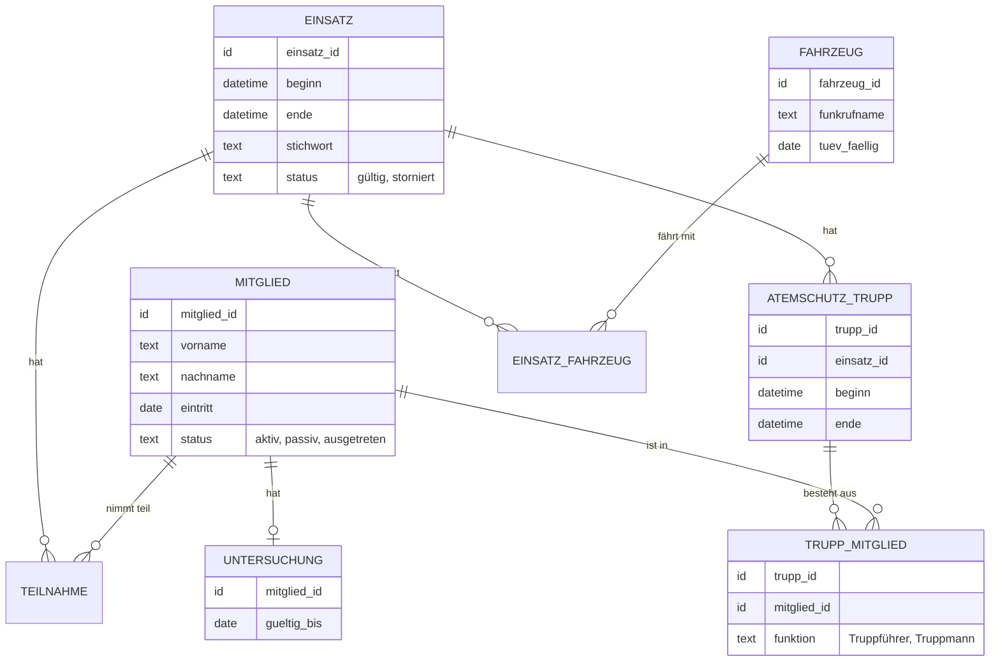

# Modul 05: Das Datenmodell ist das Fundament

Wenn eine Software ein Haus ist, dann ist das Datenmodell das Fundament. Man sieht es nicht, aber alles steht darauf. Ein schiefes Fenster tauscht man an einem Nachmittag. Ein schiefes Fundament bekommt man kaum noch gerade, wenn das Haus erst einmal steht. In diesem Modul lernst du, was ein Datenmodell ist, warum Fehler darin so teuer sind und woran du erkennst, dass deine Idee das Fundament berührt.

## Was ist ein Datenmodell?

Das Datenmodell legt fest, **welche Dinge** sich die Software merkt, **welche Eigenschaften** diese Dinge haben und **wie sie zusammenhängen**.

Stell dir einen gut sortierten Aktenschrank im Gerätehaus vor:

- Es gibt eine **Schublade pro Art von Ding**: eine für Mitglieder, eine für Fahrzeuge, eine für Einsätze. In der Fachsprache heißt so eine Art von Ding **Entität** (oder Tabelle).
- In jeder Schublade liegen **Karteikarten**, eine pro konkretem Ding: eine Karte für jedes Mitglied, eine für jedes Fahrzeug. Das ist ein **Datensatz**.
- Jede Karteikarte hat **Felder**: Name, Geburtsdatum, Eintrittsdatum. Das sind die **Attribute**.
- Jede Karte hat oben rechts eine **eindeutige Nummer**, die sich nie ändert, z. B. "M-0042". Das ist der **Schlüssel**. Über ihn findet man genau diese eine Karte wieder.
- Auf der Karte eines Einsatzes steht nicht der Name des Fahrzeugs, sondern seine Nummer, z. B. "F-03". Das ist ein **Verweis** (Fachbegriff: Fremdschlüssel). So entsteht eine **Beziehung** zwischen Einsatz und Fahrzeug.

Beziehungen gibt es in drei Formen:

| Form | Beispiel |
| --- | --- |
| eins zu eins | ein Mitglied hat genau einen Atemschutz-Nachweis |
| eins zu viele | ein Fahrzeug hat viele Prüftermine |
| viele zu viele | ein Einsatz hat viele Teilnehmer, und ein Mitglied war bei vielen Einsätzen |

## Ein kleiner Ausschnitt aus dem Wachbuch

So könnte ein Teil des Wachbuch-Datenmodells aussehen. Die Kästen sind Entitäten, die Linien Beziehungen. Ein solches Bild heißt ER-Diagramm (Entity-Relationship, also "Dinge und Beziehungen").

Was man daran sieht:

- Der Einsatz wird **storniert**, nicht gelöscht (Feld "status").
- Mitglieder sind über **Verweise** mit Einsätzen verbunden, nicht über ihren Namen.
- Die Untersuchung ist eine **eigene Entität**. So kann man für sie eigene, strengere Rechte vergeben.
- Der Atemschutz-Nachweis taucht gar nicht als eigene Tabelle auf. Er wird aus Trupps und Übungen **berechnet**. So gibt es nur eine Quelle der Wahrheit (vgl. das Gespräch in Modul 02).

## Warum das Datenmodell so wichtig ist

- **Alles baut darauf auf.** Bildschirme, Auswertungen, Rechte, Schnittstellen: Sie alle lesen und schreiben diese Daten.
- **Daten überleben den Code.** Code kann man neu schreiben. Daten von zehn Jahren Feuerwehrarbeit nicht.
- **Änderungen sind aufwendig.** Ist die Software in Betrieb, müssen bei einer Änderung alle vorhandenen Daten umgebaut werden. Das nennt man **Migration**. Geht dabei etwas schief, sind Daten falsch oder weg.

Nicht jede neue Funktion ändert das Datenmodell. Ein neuer Filter, eine andere Sortierung oder ein schöneres Formular kommen meist ohne aus. Aber viele Funktionen, die nach "nur ein kleines Feld" klingen, berühren das Fundament.

## Teure und gefährliche Fehler: sieben Beispiele

### 1. E-Mail-Adresse als Login-Identität

Die Idee: Jedes Mitglied meldet sich mit seiner E-Mail-Adresse an, die E-Mail-Adresse ist gleichzeitig die eindeutige Nummer der Person.

Das Problem: Familie Müller hat eine gemeinsame E-Mail-Adresse, und Vater und Tochter sind beide in der Wehr. Nur eine von beiden kann sich anmelden. Und wenn jemand den Anbieter wechselt und eine neue Adresse bekommt, ist er für die Software plötzlich eine neue Person, mit leerem Nachweis.

Besser: Jede Person hat eine eigene, feste Nummer. Die E-Mail-Adresse ist nur ein änderbares Feld.

### 2. Endgültiges Löschen zerstört Nachweise

Die Idee: Tritt jemand aus, wird er gelöscht. Datensparsamkeit ist doch gut.

Das Problem: Mit der Person verschwinden auch ihre Teilnahmen an Einsätzen und Lehrgängen. Plötzlich hatte ein Einsatz nur zwei statt vier Atemschutzgeräteträger, und die Statistik für die Gemeinde stimmt nicht mehr. Im schlimmsten Fall kann man einen Nachweis nicht mehr erbringen, der rechtlich verlangt wird.

Besser: Personen auf "ausgetreten" setzen und persönliche Daten nach festen Fristen gezielt entfernen oder unkenntlich machen. Wie genau, entscheidet der Architekt mit der Security- oder Datenschutz-Verantwortlichen.

### 3. Freitext statt Verweis

Die Idee: Beim Einsatz trägt man das Fahrzeug einfach als Text ein.

Das Problem: Der eine schreibt "HLF 20", der nächste "HLF20", der dritte "Hlf 20/1". Die Auswertung "Einsätze pro Fahrzeug" zeigt drei verschiedene Fahrzeuge. Bei der Pension Seeblick ist es dasselbe: "Zimmer 3", "Zi. 3", "Seeblick-Doppel".

Besser: Fahrzeuge als eigene Entität, beim Einsatz nur auswählen. Freitext nur dort, wo wirklich frei geschrieben wird, z. B. in einer Bemerkung.

### 4. Eine Tabelle für alles

Die Idee: Damit man flexibel ist, gibt es eine einzige Tabelle "Einträge", in der jede Zeile ein Feld "Typ" und ein Feld "Inhalt" hat. Der Inhalt ist beliebig strukturierter Text (z. B. im Format JSON).

Das Problem: Die Datenbank kann nicht mehr prüfen, ob die Daten stimmen. Ein Einsatz ohne Datum? Geht. Ein Geburtsdatum "gestern"? Geht. Und Rechte lassen sich nicht mehr pro Feld vergeben: Wer die Tabelle lesen darf, liest alles, auch die Untersuchungsdaten. Coding-Agenten schlagen so etwas gern vor, weil es schnell geht.

Besser: Klare Entitäten mit klaren Feldern. Flexibilität nur dort, wo sie wirklich gebraucht wird, und mit dem Architekten abgesprochen.

### 5. Keine Historie

Die Idee: Wird ein Wert geändert, wird der alte einfach überschrieben.

Das Problem: Plötzlich steht beim Atemschutzgerät "Prüfung bestanden", obwohl es letzte Woche noch "durchgefallen" hieß. Wer hat das geändert? Wann? Warum? Niemand weiß es. Bei Prüfungen und Nachweisen ist das nicht nur ärgerlich, sondern kann im Schadensfall zum Problem werden.

Besser: Für wichtige Daten festhalten, wer wann was geändert hat (Fachbegriff: Änderungsprotokoll oder Audit-Log).

### 6. Daten verschiedener Organisationen vermischt

Die Idee: Die Nachbarwehr findet das Wachbuch auch gut. Man legt sie einfach in derselben Datenbank mit an.

Das Problem: Wenn das Datenmodell nicht von Anfang an weiß, zu welcher Organisation ein Datensatz gehört, sieht die Nachbarwehr plötzlich die Mitglieder aus Musterstadt. Ein einziger vergessener Filter reicht. Software, die mehrere Organisationen getrennt bedient, nennt man **mandantenfähig**, jede Organisation ist ein **Mandant**. Das nachträglich einzubauen, ist eine der teuersten Änderungen überhaupt.

Besser: Früh entscheiden, ob es jemals mehrere Organisationen geben soll. Wenn ja, gehört das von Anfang an ins Datenmodell und wird bei jeder Abfrage geprüft.

### 7. Gesundheitsdaten an der falschen Stelle

Die Idee: Das Datum der Tauglichkeitsuntersuchung kommt einfach als Feld in die Mitglieder-Tabelle. Ist ja nur ein Datum.

Das Problem: Die Mitglieder-Tabelle sehen viele: Gruppenführer, Kassenwart, die Telefonliste. Gesundheitsdaten sind aber besonders geschützt, und nur wenige dürfen sie sehen. Liegen sie mitten in den allgemeinen Daten, landen sie in Exporten, Listen und Bildschirmen, wo sie nicht hingehören.

Besser: Sensible Daten in eine eigene Entität mit eigenen Rechten, wie im Diagramm oben. Bei der Pension gilt Ähnliches für Ausweisdaten oder Zahlungsinformationen von Gästen.

## Woran du eine Datenmodell-Entscheidung erkennst

Stell dir bei jeder Idee diese Fragen. Lautet eine Antwort "ja", berührt deine Idee wahrscheinlich das Datenmodell:

- Muss sich die Software etwas **Neues merken**, das es bisher nicht gibt?
- Entsteht eine **neue Beziehung**, z. B. zwischen Trupp und Gerät?
- Ändert sich, **was eindeutig ist**, z. B. wie man eine Person erkennt?
- Geht es um **Löschen, Stornieren oder Archivieren**?
- Sind **persönliche oder sensible Daten** betroffen?
- Gibt es künftig **zwei Stellen**, an denen dieselbe Information steht?
- Sollen **andere Organisationen** die Software mitbenutzen?
- Müssen **vorhandene Daten umgebaut** werden?

Wenn ja: Schreib es im Konzept unter "Daten" ausdrücklich auf und markiere es als Frage an den Architekten. Lass den Coding-Agenten in diesem Fall nie selbst entscheiden.

## Entscheidungen aufschreiben: das ADR

Wichtige Entscheidungen zum Datenmodell und zur Architektur werden in einem **ADR** festgehalten. ADR steht für "Architecture Decision Record", auf Deutsch "Architekturentscheidung". Das ist ein kurzes Dokument, meist eine Seite, im Projekt selbst. Es beantwortet:

- **Kontext:** Welches Problem gab es?
- **Entscheidung:** Was haben wir entschieden?
- **Alternativen:** Was haben wir noch überlegt, und warum nicht?
- **Folgen:** Was bedeutet das für die Zukunft, auch die Nachteile?

Warum das wichtig ist: In zwei Jahren fragt jemand "Warum werden Einsätze nicht gelöscht?". Ohne ADR weiß das niemand mehr, und jemand baut es "zur Vereinfachung" um. Mit ADR steht die Antwort da. Auch der Coding-Agent liest die ADRs und hält sich daran.

Die Vorlage dafür liegt unter [vorlagen/](../vorlagen/).

### Wer macht was?

- **Karl** erkennt, dass seine Idee das Datenmodell berührt, und schreibt die Frage ins Konzept.
- **Peter** entscheidet und schreibt das ADR, oder lässt Karl einen Entwurf schreiben und prüft ihn.
- **Sabine** wird gefragt, wenn persönliche oder sensible Daten betroffen sind.

Im Beispiel aus Modul 03 hat Peter genau das getan: Die Frage "Stornieren statt Löschen" hat er erkannt, ein ADR dazu angekündigt und die Umsetzung davon abhängig gemacht.

## Kurz zusammengefasst

- Das Datenmodell legt fest, welche Dinge sich die Software merkt und wie sie zusammenhängen.
- Fehler darin sind teuer, weil Daten länger leben als Code und Umbauten alle vorhandenen Daten betreffen.
- Manche Fehler sind gefährlich: Sie zerstören Nachweise oder geben Daten an die Falschen.
- Erkenne Datenmodell-Fragen früh, schreib sie ins Konzept, und lass den Architekten entscheiden.
- Entscheidungen werden als ADR festgehalten.

Weiter mit [Modul 06: Mit dem Coding-Agenten arbeiten](06-coding-agent.md).
