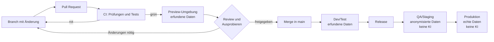

# Modul 11: Umgebungen und Zusammenarbeit

Eine Software läuft nicht nur an einem Ort. Es gibt Installationen zum Ausprobieren, zum Testen und für den echten Betrieb. In diesem Modul lernst du, welche **Umgebungen** es gibt, welche Daten dort liegen, wer (und welche KI) darauf zugreifen darf und wie viele Menschen gleichzeitig an derselben Software arbeiten können, ohne sich gegenseitig zu stören.

Die Grundidee der Umgebungen kennst du schon aus [Web und Daten](grundlagen/web-und-daten.md#umgebungen-entwicklung-test-produktion). Hier wird sie genauer und mit Blick auf KI-Agenten erklärt.

## Was ist eine Umgebung?

Eine **Umgebung** ist eine eigene, vollständige Installation der Software: eigener Server, eigene Datenbank, eigene Zugangsdaten. Was in einer Umgebung passiert, hat keine Auswirkung auf die anderen.

Ein Bild dazu: Die Feuerwehr übt einen Innenangriff nicht im brennenden Wohnhaus, sondern in der Übungsanlage. Erst wenn alles sitzt, geht es in den Einsatz. Bei Software ist es genauso: erst üben, dann prüfen, dann ernst.

## Die Umgebungen im Überblick

### Lokale Entwicklung (optional, für Erfahrene)

Die Software läuft auf dem eigenen Rechner, egal ob Mac, Windows oder Linux. Das ist schnell und flexibel, braucht aber Einrichtung: Git, Programmiersprache, Datenbank, oft Docker (siehe [Werkzeuge](grundlagen/werkzeuge.md)). Für Einsteiger ist das nicht nötig. Wer mit einem Coding-Agenten in der Cloud arbeitet ([Modul 06](06-coding-agent.md)), braucht keine lokale Umgebung.

### Vorschau-Umgebung (Preview) pro Entwickler oder pro Pull Request

Viele Projekte erzeugen für jeden Pull Request automatisch eine eigene kleine Installation, eine **Preview**. Die CI-Pipeline baut die Software aus dem Branch, startet sie mit erfundenen Daten und schreibt einen Link in den Pull Request. Karl klickt auf den Link und probiert seine Änderung im Browser aus, ohne irgendetwas zu installieren. Nach dem Merge wird die Preview automatisch wieder gelöscht.

Manche Projekte geben stattdessen jedem Entwickler eine eigene dauerhafte Entwicklungsumgebung in der Cloud. Der Vorteil ist derselbe: Jeder hat seinen eigenen Spielplatz.

### Gemeinsame Entwicklungs- und Testumgebung (dev/test)

Hier landet nach jedem Merge automatisch der aktuelle Stand von `main`. Alle Mitwirkenden testen dort gemeinsam, ob die neuen Funktionen zusammenpassen. Die Daten sind **synthetisch**, also erfunden: "Max Mustermann", "HLF 20 Musterstadt", "Atemschutzgerät 7".

### QA oder Staging

**QA** (Quality Assurance, Qualitätssicherung) oder **Staging** ist die letzte Station vor dem echten Betrieb. Sie ist möglichst genau wie die Produktion aufgebaut. Hier prüft man ein Release, bevor es ausgeliefert wird.

Vorsicht: In manchen Organisationen arbeitet QA mit echten oder aus der Produktion kopierten Daten, um realistisch zu testen. Dann gilt: **KI-Agenten und KI-Chats haben dort keinen Zugriff.** Kein Agent bekommt Zugangsdaten zu QA, und niemand kopiert Inhalte, Screenshots oder Logs aus QA in einen KI-Chat. Besser ist, wenn QA mit **anonymisierten** Daten arbeitet: echte Struktur, aber Namen, Adressen und Gesundheitsangaben sind ersetzt, sodass kein Rückschluss auf echte Menschen möglich ist. Ob die Anonymisierung wirklich reicht, entscheiden Architekt und Datenschutzbeauftragter, nicht der Agent.

### Produktion (prod)

Die echte Software, die die Wehr täglich nutzt, mit echten Daten der Mitglieder. Zugang zur Technik dahinter (Server, Datenbank) haben nur wenige Administratoren. **KI-Agenten haben hier niemals Zugriff**, auch nicht "nur lesend" und auch nicht zum Fehlersuchen. Fehler aus der Produktion werden mit erfundenen Daten in einer anderen Umgebung nachgestellt ([Modul 12](12-testen.md#erst-der-test-dann-die-korrektur)).

## Übersicht: Daten und Zugriff

| Umgebung | Daten | Wer hat Zugriff | Darf ein KI-Agent zugreifen? |
| --- | --- | --- | --- |
| Lokal | erfunden | wer sie eingerichtet hat | ja |
| Preview pro PR oder pro Entwickler | erfunden | Team, oft per Link | ja |
| Dev/Test (gemeinsam) | erfunden | alle Mitwirkenden | ja |
| QA/Staging | anonymisiert, in manchen Organisationen echt oder kopiert | wenige ausgewählte Tester und Admins | nein, solange dort echte oder nur teilweise anonymisierte Daten liegen |
| Produktion | echt | Nutzer über die Oberfläche, Technik nur Admins | nein, nie |

Faustregel: **Wo echte Daten sind, ist keine KI.** Mehr zu Daten und KI-Diensten in [Modul 14](14-ki-und-datenschutz.md).

## Der Weg des Codes

## CI/CD grob erklärt

**CI** (Continuous Integration) kennst du aus [Modul 07](07-pull-request-und-review.md): Bei jedem Pull Request laufen automatisch Prüfungen und Tests. **CD** (Continuous Delivery oder Deployment) ist der nächste Schritt: Geprüfte Stände werden automatisch ausgeliefert, zuerst in die Preview, nach dem Merge nach Dev/Test, nach einem Release nach QA und schließlich in die Produktion.

Die Abfolge dieser Schritte heißt **Pipeline**. Sie ist im Repository beschrieben (bei GitHub z. B. in Dateien unter `.github/workflows/`) und läuft bei jeder Änderung gleich ab. Kein Mensch muss Dateien von Hand auf einen Server kopieren. Das hat zwei Vorteile: Es passieren weniger Fehler, und man weiß immer genau, welche Version wo läuft.

Den Schritt in die Produktion lösen meist Menschen bewusst aus, z. B. Peter mit einem Release ([Modul 09](09-wartung-und-releases.md#release-konzepte)). Änderungen an der Pipeline selbst sind heikel, weil sie bestimmen, was geprüft wird. Sie gehören in einen eigenen Pull Request und werden besonders genau gelesen.

## Viele Leute, viele Funktionen, gleichzeitig

Im Wachbuch arbeiten oft mehrere Leute gleichzeitig: Karl baut an der Atemschutz-Übersicht, der Gerätewart am Fahrzeugcheck, Jonas an der Handy-Ansicht. Jeder hat dabei vielleicht noch zwei Agenten-Sitzungen offen. Damit das klappt, arbeitet jeder in seinem eigenen **Branch** (siehe [Versionskontrolle](grundlagen/versionskontrolle.md)).

### Was ist ein Merge-Konflikt?

Ein **Merge-Konflikt** entsteht, wenn zwei Branches dieselbe Stelle derselben Datei unterschiedlich geändert haben. Git kann dann nicht entscheiden, welche Fassung gilt, und fragt nach. Beispiel: Karl benennt in der Fahrzeugliste die Spalte "Kennzeichen" in "Amtl. Kennzeichen" um, der Gerätewart fügt in derselben Zeile eine Spalte "Kilometerstand" ein. Wer zuerst mergt, hat Glück. Der andere muss den Konflikt auflösen.

Konflikte sind normal und kein Fehler. Gefährlich wird es, wenn sie falsch aufgelöst werden und dabei die Änderung eines anderen still verloren geht. Agenten lösen Konflikte oft selbst, prüfe aber im Diff, ob nichts verschwunden ist.

### So vermeidet ihr Konflikte

- **Kleine, atomare Pull Requests.** Atomar heißt: Ein Pull Request enthält genau eine Sache, die für sich funktioniert. Je kleiner, desto seltener kollidiert er.
- **Ein Thema pro Pull Request.** Keine "Aufräumarbeiten nebenbei" in Dateien, an denen andere gerade arbeiten.
- **Kurzlebige Branches.** Ein Branch sollte Tage alt werden, nicht Wochen. Je länger er liegt, desto weiter entfernt sich `main`.
- **Oft aktualisieren.** Den eigenen Branch regelmäßig auf den neuesten Stand von `main` bringen (das heißt **Rebase**). Dann sind Konflikte klein und frisch. Der Agent kann das für dich tun: "Bringe meinen Branch auf den Stand von main und zeige mir, ob es Konflikte gab."
- **Reden.** Im Issue kurz schreiben, woran man arbeitet. Wenn zwei Issues dieselben Dateien betreffen, vorher absprechen, wer zuerst.

### Große Umbauten nur nach Absprache

Manchmal muss etwas Grundsätzliches umgebaut werden, ein sogenannter **Refactor**: z. B. die ganze Rechteprüfung neu ordnen oder die Datenbankstruktur aufteilen. So etwas dauert zwei, drei Tage oder eine Woche und berührt viele Dateien. In dieser Zeit kollidiert fast jeder andere Pull Request damit.

Deshalb gilt: Große Umbauten nur nach **Absprache mit dem Maintainer** und **vorher angekündigt**, z. B. "Von Montag bis Mittwoch baue ich die Rechteprüfung um, bitte in dieser Zeit keine Pull Requests in diesem Bereich." Ein Agent schlägt solche Umbauten gern nebenbei vor, weil der Code dann "schöner" wird. Das ist kein Grund, ihn einfach machen zu lassen.

### Warum eigene Umgebungen helfen

Wenn alle in derselben Dev-Umgebung testen, stören sie sich gegenseitig: Karls halbfertige Änderung bricht die Seite, auf der der Gerätewart gerade testet, oder einer löscht Testdaten, die der andere braucht. Mit einer Preview pro Pull Request oder einer Umgebung pro Entwickler testet jeder seine Änderung für sich, und erst nach dem Review kommt alles in der gemeinsamen Umgebung zusammen. Bei mehreren gleichzeitigen Agenten-Sitzungen ist das besonders wertvoll.

## Checkliste

- [ ] Ich weiß, in welcher Umgebung ich gerade bin, bevor ich etwas eintrage oder lösche.
- [ ] Ich nutze nur Umgebungen mit erfundenen Daten für Versuche und für KI-Agenten.
- [ ] Kein Agent und kein KI-Chat bekommt Zugang, Inhalte, Screenshots oder Logs aus QA oder Produktion.
- [ ] Mein Pull Request behandelt genau ein Thema.
- [ ] Mein Branch ist nicht älter als ein paar Tage und auf dem Stand von `main`.
- [ ] Größere Umbauten habe ich vorher mit dem Maintainer abgesprochen und angekündigt.

## Zusammenfassung

- Umgebungen sind getrennte Installationen: lokal, Preview, Dev/Test, QA, Produktion.
- Erfundene Daten in allen Umgebungen, in denen entwickelt wird. Wo echte Daten sind, ist keine KI.
- CI prüft jede Änderung, CD liefert sie automatisch Schritt für Schritt aus.
- Konflikte vermeidet man mit kleinen, kurzlebigen Pull Requests zu einem Thema und häufigem Rebase.
- Große Umbauten nur nach Absprache und Ankündigung.

## Quellen

Stand 2026-11-12.

- [GitHub Docs: Understanding GitHub Actions](https://docs.github.com/en/actions/about-github-actions/understanding-github-actions)
- [GitHub Docs: About merge conflicts](https://docs.github.com/en/pull-requests/collaborating-with-pull-requests/addressing-merge-conflicts/about-merge-conflicts)
- [GitHub Docs: Managing environments for deployment](https://docs.github.com/en/actions/managing-workflow-runs-and-deployments/managing-deployments/managing-environments-for-deployment)
