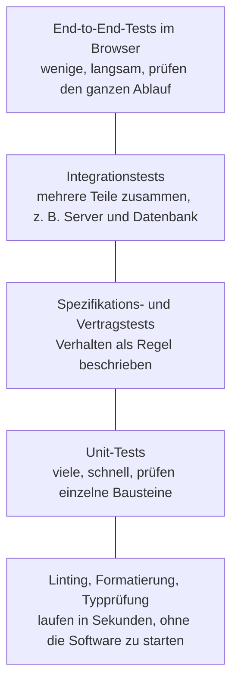

# Modul 12: Testen

**Testen ist der wichtigste Punkt in der KI-Entwicklung.** In diesem Modul lernst du, warum das so ist, welche Arten von Tests es gibt, wie ein Test aussieht, der die Software im Browser bedient, und was du als Fachexperte beitragen kannst, auch ohne eine Zeile Code zu schreiben.

## Warum Tests so wichtig sind

Ein Coding-Agent ändert in wenigen Minuten dutzende Dateien. Er tut das schnell, fleißig und mit großer Überzeugung ([Modul 06](06-coding-agent.md#agenten-können-sich-sicher-irren)). Er weiß aber nicht, was er dabei nebenbei kaputt macht. Und du kannst nach jeder Änderung nicht von Hand alle Funktionen des Wachbuchs durchklicken.

Ein **automatischer Test** ist ein kleines Programm, das eine Funktion der Software ausführt und prüft, ob das erwartete Ergebnis herauskommt. Hunderte solcher Tests laufen in wenigen Minuten. Nur sie sagen dir zuverlässig: Die alten Funktionen tun noch, was sie sollen.

Ein Bild dazu: Nach jeder Wartung am Fahrzeug macht der Gerätewart eine Funktionsprobe. Pumpe an, Licht an, Funk an. Er verlässt sich nicht darauf, dass die Werkstatt schon nichts verstellt hat. Tests sind die Funktionsprobe für Software, nur dass sie nach jeder einzelnen Änderung automatisch laufen.

## Die Testpyramide

Es gibt verschiedene Arten von Prüfungen. Unten in der Pyramide stehen schnelle, einfache Prüfungen, von denen es viele gibt. Oben stehen langsame, aufwendige Tests, von denen es weniger gibt.



| Stufe | Was geprüft wird | Beispiel Wachbuch |
| --- | --- | --- |
| **Linting und Formatierung** | Stil und typische Programmierfehler, einheitliches Aussehen des Codes | eine Variable wird benutzt, aber nie gesetzt |
| **Typprüfung** | ob überall die richtige Art von Daten verwendet wird | ein Datum wird nicht versehentlich wie ein Text behandelt |
| **Unit-Tests** | ein einzelner Baustein für sich | die Funktion "nächstes Prüfdatum berechnen" liefert für eine Prüfung am 2026-03-15 mit 12 Monaten Frist den 2027-03-15 |
| **Spezifikations- und Vertragstests** | Verhalten, als feste Regel beschrieben; bei Schnittstellen auch, ob Anfrage und Antwort zur Absprache passen | "Gegeben ein Gerät mit abgelaufener Prüfung, wenn die Übersicht geladen wird, dann ist es rot markiert" |
| **Integrationstests** | mehrere Teile zusammen, z. B. Server mit echter Testdatenbank | eine gespeicherte Prüfung ist danach wirklich in der Datenbank |
| **End-to-End-Tests (E2E)** | die ganze Anwendung, bedient wie von einem Menschen im Browser | anmelden, Fahrzeugcheck eintragen, Eintrag in der Liste sehen |

Linting, Formatierung und Typprüfung kennst du schon aus der CI in [Modul 07](07-pull-request-und-review.md#stufe-1-automatische-prüfungen-ci).

### Spezifikation als Gegeben, Wenn, Dann

Viele Projekte beschreiben Verhalten in einer festen Form, oft auf Englisch "given, when, then":

```text
Gegeben ein Atemschutzgerät mit letzter Prüfung am 2025-10-01 und 12 Monaten Prüffrist
Wenn der Gerätewart am 2026-11-12 die Geräteübersicht öffnet
Dann ist das Gerät als "Prüfung überfällig" markiert
Und es darf nicht als einsatzbereit angezeigt werden
```

Das ist fast normale Sprache. Genau hier kannst du als Fachexperte direkt mitschreiben.

## Wie ein End-to-End-Test aussieht

Für Tests im echten Browser gibt es Werkzeuge wie **Playwright** ([playwright.dev](https://playwright.dev/)) oder **Cypress** ([cypress.io](https://www.cypress.io/)). Sie starten einen Browser, klicken, tippen und prüfen, was auf dem Bildschirm erscheint. Hier ein kurzer Playwright-Test für das Wachbuch, geschrieben in TypeScript:

```ts
import { test, expect } from '@playwright/test';

test('Gerätewart trägt einen Fahrzeugcheck ein', async ({ page }) => {
  await page.goto('/login');
  await page.getByLabel('Benutzername').fill('test-geraetewart');
  await page.getByLabel('Passwort').fill(process.env.TEST_PASSWORT!);
  await page.getByRole('button', { name: 'Anmelden' }).click();

  await page.getByRole('link', { name: 'Fahrzeuge' }).click();
  await page.getByRole('link', { name: 'HLF 20 Musterstadt' }).click();
  await page.getByRole('button', { name: 'Fahrzeugcheck eintragen' }).click();
  await page.getByLabel('Kilometerstand').fill('48213');
  await page.getByLabel('Tank voll').check();
  await page.getByRole('button', { name: 'Speichern' }).click();

  await expect(page.getByText('Fahrzeugcheck gespeichert')).toBeVisible();
  await expect(page.getByRole('row', { name: /48213/ })).toBeVisible();
});
```

Zeile für Zeile in einfachen Worten:

- `import ...`: Holt die Werkzeuge von Playwright: `test` zum Beschreiben eines Tests, `expect` zum Prüfen.
- `test('Gerätewart trägt ...', ...)`: Der Name des Tests. Er beschreibt in normaler Sprache, was geprüft wird. Schlägt der Test fehl, steht genau dieser Satz in der Meldung.
- `page.goto('/login')`: Öffnet im Browser die Anmeldeseite.
- `getByLabel('Benutzername').fill(...)`: Sucht das Eingabefeld mit der Beschriftung "Benutzername" und tippt einen Test-Benutzer hinein. Es ist ein erfundener Benutzer, der nur in der Testumgebung existiert.
- `process.env.TEST_PASSWORT`: Das Passwort steht nicht im Code, sondern kommt aus einer geschützten Einstellung der Testumgebung ([Modul 08](08-sicherheit.md#geheimnisse-im-code)).
- `getByRole('button', { name: 'Anmelden' }).click()`: Klickt auf den Knopf "Anmelden".
- Die nächsten drei Zeilen: Klickt sich zum Fahrzeug "HLF 20 Musterstadt" durch und öffnet das Formular für den Fahrzeugcheck.
- `getByLabel('Kilometerstand').fill('48213')`: Trägt einen erfundenen Kilometerstand ein.
- `getByLabel('Tank voll').check()`: Setzt das Häkchen bei "Tank voll".
- `click()` auf "Speichern": Speichert den Eintrag.
- `expect(...).toBeVisible()`: Die eigentliche Prüfung. Erscheint die Meldung "Fahrzeugcheck gespeichert"? Und gibt es in der Liste eine Zeile mit 48213? Wenn nicht, ist der Test rot.

Der Test sucht Felder und Knöpfe über ihre sichtbare Beschriftung, so wie ein Mensch. Das hat einen Nebeneffekt: Eine Seite, die sich so testen lässt, ist meist auch für Menschen mit Bildschirmleser gut bedienbar.

## Die Testkette läuft bei jeder Änderung

Alle Tests laufen in der CI bei **jedem** Pull Request und bei jedem Merge, nicht nur ab und zu ([Modul 11](11-umgebungen-und-zusammenarbeit.md#cicd-grob-erklärt)). Die Kette muss jedes Mal vollständig durchlaufen. Ein einziger roter Test heißt: nicht mergen.

Für die Arbeit mit dem Agenten bedeutet das:

- Verlange im Auftrag, dass der Agent die Tests ausführt und das Ergebnis zeigt. Agenten behaupten manchmal, Tests seien grün, ohne sie ausgeführt zu haben.
- Neue Funktion heißt neuer Test. Ein Pull Request ohne Test für das neue Verhalten ist nicht fertig.
- Ein roter Test wird repariert, nicht gelöscht, übersprungen oder abgeschwächt. Wenn der Agent das vorschlägt: Stopp ([Modul 06](06-coding-agent.md#den-agenten-steuern-und-hinterfragen)).

## Erst der Test, dann die Korrektur

Bei einem Fehler gilt eine einfache Reihenfolge:

1. **Nachstellen:** Den Fehler mit erfundenen Daten in einer Testumgebung nachstellen. Nie mit echten Daten aus der Produktion.
2. **Test schreiben, der rot ist:** Ein Test, der genau diesen Fehler zeigt. Er muss vor der Korrektur fehlschlagen, sonst prüft er das Falsche.
3. **Korrigieren:** Jetzt den Fehler beheben, bis der Test grün ist.
4. **Alle Tests laufen lassen:** Prüfen, dass nichts anderes kaputtgegangen ist.

Der Test bleibt danach für immer im Projekt. So kann derselbe Fehler nicht unbemerkt zurückkommen. Ein Auftrag an den Agenten kann so beginnen: "Schreibe zuerst einen Test, der den Fehler aus Issue #57 zeigt, und zeige mir, dass er fehlschlägt. Ändere noch keinen anderen Code."

## Tests sind oft mehr Code als die Software selbst

Es ist normal, dass der Testcode ein Vielfaches des eigentlichen Codes ausmacht, oft das Zwei- bis Dreifache oder mehr. Das ist kein Zeichen von Übertreibung, sondern das Sicherheitsnetz, das schnelle Änderungen mit Agenten überhaupt erst möglich macht.

## Tests brauchen Pflege

Tests sind Code und altern wie Code:

- **Veraltete Tests:** Wenn sich das gewünschte Verhalten bewusst ändert (z. B. neue Prüffrist), wird der Test angepasst. Im Pull Request steht dann, warum.
- **Doppelte Tests:** Prüfen fünf Tests dasselbe, kosten sie Zeit, ohne mehr Sicherheit zu bringen. Ausmisten ist erlaubt, aber **nur bewusst**: als eigener Pull Request, mit Begründung, mit Review. Nie nebenbei, nie, damit es grün wird.
- **Wackelnde Tests (flaky):** Ein Test, der mal grün und mal rot ist, ohne dass sich etwas geändert hat. Ursachen sind oft Zeitabhängigkeiten oder Tests, die sich gegenseitig stören. Flaky Tests sind gefährlich, weil man sich angewöhnt, rote Ergebnisse zu ignorieren. Sie werden als Issue gemeldet und repariert, nicht einfach neu gestartet, bis sie grün sind.

## Testdaten sind immer erfunden

Tests brauchen Daten: Mitglieder, Fahrzeuge, Geräte. Diese Daten sind immer **synthetisch**, also erfunden. "Max Mustermann", "Erika Beispiel", "HLF 20 Musterstadt". Nie eine Kopie der echten Mitgliederliste, auch nicht "anonymisiert durch Weglassen der Nachnamen". Der Agent hilft gern beim Erfinden passender Testdaten. Mehr in [Modul 14](14-ki-und-datenschutz.md).

## Was du als Fachexperte beiträgst

Du musst keine Tests programmieren. Aber du weißt, was richtig ist, und vor allem, welche **Sonderfälle** es gibt. Das ist das Wertvollste, was ein Test bekommen kann.

Schreib im Issue in einfachen Worten auf, was passieren soll:

```text
Erwartetes Verhalten Atemschutz-Übersicht:
- Untersuchung gültig bis in mehr als 3 Monaten: grün
- gültig bis in weniger als 3 Monaten: gelb
- abgelaufen: rot, und die Person wird nicht als einsatzbereit gezählt
Sonderfälle:
- Person hat noch nie eine Untersuchung gehabt: rot, nicht leer
- Untersuchung läuft genau heute ab: gilt heute noch, ab morgen rot
- Person ist in der Alters- und Ehrenabteilung: taucht gar nicht auf
- Schaltjahr: Untersuchung am 29. Februar, Frist 36 Monate
```

Daraus kann der Agent direkt Tests machen: "Schreibe für jeden dieser Fälle einen Test." Solche Listen sind hervorragendes Prompt-Material. Das Datum "genau heute" oder der 29. Februar sind genau die Fälle, an die ein Agent allein nicht denkt.

Nach dem Merge probierst du außerdem selbst in der Testumgebung aus, ob es sich in der Praxis richtig anfühlt ([Fachliche Prüfung](fachliche-pruefung.md)). Tests prüfen, ob die Regeln eingehalten werden. Ob die Regeln die richtigen sind, weißt nur du.

## Regeln stehen im Repository

Damit der Agent weiß, wie im Projekt getestet wird, stehen die Regeln im Repository: in `AGENTS.md` und in den Standards des Projekts ([Modul 10](10-standards.md)). Typische Einträge:

- welche Befehle vor jedem Pull Request laufen müssen (z. B. Lint, Typprüfung, Unit-Tests, E2E-Tests),
- "Jede neue Funktion braucht Tests, jeder Fehler zuerst einen roten Test",
- "Tests nie löschen oder überspringen, um grün zu werden",
- "Nur erfundene Testdaten",
- wo die Testdaten-Erzeugung liegt.

Der Agent liest diese Regeln automatisch. Was nicht dort steht, kann er nicht wissen.

## Checkliste

- [ ] Das erwartete Verhalten und die Sonderfälle stehen in einfachen Worten im Issue.
- [ ] Der Agent hat für jedes neue Verhalten Tests geschrieben.
- [ ] Bei einem Fehler gibt es einen Test, der vor der Korrektur rot war.
- [ ] Ich habe gesehen, dass die Tests wirklich gelaufen sind (CI grün, nicht nur "laut Agent").
- [ ] Kein Test wurde gelöscht, übersprungen oder abgeschwächt, ohne dass das begründet und abgesprochen ist.
- [ ] Alle Testdaten sind erfunden.
- [ ] Ich habe die Funktion selbst in der Testumgebung ausprobiert.

## Zusammenfassung

- Agenten ändern viel und schnell. Nur Tests zeigen, ob das Alte noch funktioniert.
- Die Pyramide: viele schnelle Prüfungen unten, wenige E2E-Tests im Browser oben.
- Alle Tests laufen bei jeder Änderung in der CI. Rot heißt: nicht mergen.
- Bei Fehlern zuerst ein roter Test, dann die Korrektur.
- Tests sind oft mehr Code als die Software, brauchen Pflege und werden nur bewusst ausgemistet.
- Dein Beitrag: erwartetes Verhalten und Sonderfälle in einfachen Worten.

## Quellen

Stand 2026-11-12.

- [Playwright: Writing tests](https://playwright.dev/docs/writing-tests)
- [Playwright: Locators (getByRole, getByLabel)](https://playwright.dev/docs/locators)
- [Cypress Documentation](https://docs.cypress.io/)
- [Martin Fowler: The Practical Test Pyramid](https://martinfowler.com/articles/practical-test-pyramid.html)
- [Martin Fowler: GivenWhenThen](https://martinfowler.com/bliki/GivenWhenThen.html)
