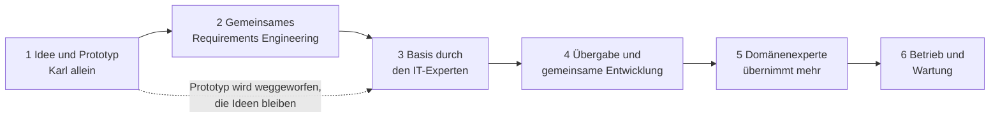

# Modul 15: Vom Proof of Concept zur gemeinsamen Entwicklung

Die anderen Module beschreiben, wie Domänenexperten und IT-Experten an einer **laufenden** Software zusammenarbeiten. Dieses Modul zeigt den Weg davor und danach: Wie entsteht aus einer Idee ein Projekt, wann übernimmt wer welche Aufgabe, und wie verschiebt sich die Verantwortung mit der Zeit? Am Ende steht eine Software, die der Domänenexperte weitgehend selbst weiterentwickelt und die trotzdem sicher und wartbar bleibt.

Das Beispiel bleibt das Wachbuch der Freiwilligen Feuerwehr Musterstadt (siehe [Modul 01](01-rollen-und-ablauf.md)): Karl ist Atemschutzgerätewart und Domänenexperte, Peter ist externer Softwarearchitekt und betreut mehrere Vereinsprojekte, Sabine prüft Sicherheit und Datenschutz (optional). Der Kommandant legt die Prioritäten fest.

## Die Phasen im Überblick

Die Phasen gehen fließend ineinander über. Wichtig ist nicht das genaue Datum des Wechsels, sondern dass alle wissen, in welcher Phase das Projekt gerade steht.

## Phase 1: Idee und Prototyp

Karl hat eine Idee: Die Prüftermine der Atemschutzgeräte stehen heute in einer Tabelle, und niemand sieht rechtzeitig, was fällig wird. Er baut an zwei Abenden einen **Prototyp**, mit einem KI-App-Builder (ein Online-Werkzeug, das aus einer Beschreibung eine klickbare App erzeugt) oder mit einem Coding-Agenten ([Modul 06](06-coding-agent.md)).

Ein paar Begriffe, die oft durcheinandergehen:

- **Prototyp:** eine schnelle Skizze, die man anklicken kann. Sie zeigt, wie es aussehen und sich anfühlen könnte.
- **Proof of Concept (PoC):** ein Nachweis, dass eine Idee grundsätzlich funktioniert, z. B. "Man kann Prüftermine automatisch aus dem letzten Prüfdatum berechnen".
- **MVP (Minimum Viable Product):** die kleinste Version, die schon echten Nutzen bringt. Ein MVP entsteht erst in Phase 3 und 4, nicht in Phase 1.

Regeln für diese Phase:

- **Wegwerfen ist eingeplant.** Der Prototyp dient dazu, die Idee zu zeigen und zu lernen. Er ist nicht für den Betrieb gedacht.
- **Nur erfundene Daten.** Keine echten Mitglieder, keine echten Gerätenummern mit Namen, keine Gesundheitsdaten. Auch nicht "nur kurz zum Testen" ([Modul 14](14-ki-und-datenschutz.md)).
- **Keine Freigabe an andere.** Der Prototyp läuft nicht im Gerätehaus und wird nicht an die Kameraden verteilt.
- **Notizen machen.** Was hat überrascht? Welche Fragen sind aufgetaucht? Genau das ist das Ergebnis dieser Phase, nicht der Code.

Ergebnis: ein Prototyp zum Vorzeigen, eine Liste mit Erkenntnissen und offenen Fragen, idealerweise ein erstes Konzept ([Modul 03](03-konzept-und-prompt.md)). Warum ein Prototyp kein produktiver Betrieb ist, erklärt [Modul 16](16-vom-prototyp-zum-betrieb.md).

## Phase 2: Gemeinsames Requirements Engineering

**Requirements Engineering** heißt: die Anforderungen sauber erheben und aufschreiben. Karl zeigt Peter den Prototyp. Gemeinsam klären sie:

- **Abläufe:** Wie läuft eine Geräteprüfung heute wirklich ab, Schritt für Schritt? Was passiert, wenn ein Gerät durchfällt?
- **Rollen:** Wer darf was sehen und ändern? Gerätewart, Gruppenführer, Kommandant, normales Mitglied.
- **Begriffe:** Was genau ist ein "Gerät", eine "Prüfung", eine "Frist"? Ein gemeinsames Glossar verhindert Missverständnisse.
- **Umfang (Scope):** Was gehört dazu, was ausdrücklich nicht? Zum Beispiel: "Prüffristen ja, Lagerverwaltung nein."
- **Grundlage für das Datenmodell:** Welche Dinge gibt es, und wie hängen sie zusammen ([Modul 05](05-datenmodell.md))?
- **Datenschutz-Einordnung:** Welche Daten sind personenbezogen, welche sind besonders sensibel (z. B. Tauglichkeit für Atemschutz als Gesundheitsdatum)? Hier ist Sabine gefragt.

Ergebnis: ein Konzept mit Scope, Rollen, Begriffen, einer ersten Skizze des Datenmodells und einer Datenschutz-Einordnung. Der Kommandant bestätigt, dass das Projekt so gewollt ist und wer es betreibt.

## Phase 3: Basis durch den IT-Experten

Jetzt baut Peter das Fundament. Das ist die Phase, in der Erfahrung am meisten zählt, weil Fehler hier später teuer werden.

- **Architektur und Technik:** Aus welchen Teilen besteht die Software, welche Programmiersprache, welches Framework, welche Datenbank? Peter entscheidet das und hält es in einem **ADR** fest ([Modul 10](10-standards.md#adrs-architekturentscheidungen)).
- **Basis-Datenmodell:** Peter entwirft es in enger Abstimmung mit Karl. Karl prüft, ob es die Wirklichkeit abbildet, Peter prüft, ob es technisch trägt.
- **Sicherheits-Grundausstattung:** Anmeldung, Rechteprüfung auf dem Server, verschlüsselte Verbindung (TLS), Geheimnisse außerhalb des Codes, Sicherungen (Backups) ([Modul 08](08-sicherheit.md)).
- **CI:** automatische Prüfungen mit Tests und Lint bei jedem Pull Request ([Modul 12](12-testen.md)).
- **Umgebungen:** mindestens eine Test-Umgebung mit erfundenen Daten ([Modul 11](11-umgebungen-und-zusammenarbeit.md)).
- **Projektrahmen:** Dokumentationsstruktur, `AGENTS.md`, Renovate für Updates, Review-Regeln, Branch-Schutz ([Ein Projekt vorbereiten](neues-projekt.md)).

Ein Projektgerüst zum Kopieren liegt im Ordner [starter/](https://github.com/slauger/domain-dev-with-ai/blob/main/starter/README.md).

### Warum der Prototyp meist nicht die Basis wird

Es ist verlockend, auf dem Prototyp weiterzubauen. Meist ist das falsch, aus mehreren Gründen:

- Der Prototyp wurde schnell gebaut, ohne Rechtekonzept, ohne Tests, oft mit fest eingebauten Annahmen.
- Sein Datenmodell entstand, bevor die Begriffe in Phase 2 geklärt waren. Ein falsches Datenmodell lässt sich später kaum korrigieren ([Modul 05](05-datenmodell.md)).
- App-Builder erzeugen oft Code, der an ihre eigene Plattform gebunden ist und sich schwer warten oder umziehen lässt.
- Sicherheit nachträglich einzubauen ist aufwendiger und fehleranfälliger als von Anfang an.

Deshalb gilt: **Den Code neu und sauber aufbauen, die Ideen behalten.** Der Prototyp bleibt als Anschauungsmaterial: Screenshots, Abläufe und Notizen wandern ins Konzept und in die Dokumentation. Ob Teile doch übernommen werden, entscheidet Peter im Einzelfall und schreibt es in den ADR.

## Phase 4: Übergabe und gemeinsame Entwicklung

Die Basis steht. Jetzt beginnt die Arbeitsweise, die der Rest der Schulung beschreibt ([Modul 01](01-rollen-und-ablauf.md#der-arbeitsablauf)):

- Karl baut Funktionen mit seinem Coding-Agenten, immer über Issue, Branch und Pull Request.
- Peter reviewt jeden Pull Request, Sabine alle mit Sicherheitsbezug.
- **Am Anfang im Pairing:** Die ersten zwei oder drei Pull Requests machen Karl und Peter gemeinsam, am Bildschirm oder per Videocall. Karl lernt, wie Peter denkt, und Peter sieht, wo Karl Hilfe braucht.
- Peter achtet darauf, dass Karl kleine, gut abgegrenzte Aufgaben bekommt, die auf der Basis aufsetzen, statt sie umzubauen.

## Phase 5: Der Domänenexperte übernimmt mehr

Mit der Zeit wird Karl sicherer. Seine Pull Requests brauchen weniger Korrekturen, er schreibt gute Tests, er kennt die ADRs. Dann zieht sich Peter schrittweise aus der täglichen Entwicklung zurück und konzentriert sich auf:

- Review von Architektur und Sicherheit,
- Updates von Abhängigkeiten und Releases ([Modul 09](09-wartung-und-releases.md)),
- neue ADRs, wenn sich grundlegend etwas ändert.

Dafür braucht es **Eskalationsregeln**, die im Projekt aufgeschrieben sind, z. B. in `CONTRIBUTING.md`:

- Änderungen am Datenmodell, an Rechten, an Anmeldung, an Betrieb oder neue Abhängigkeiten gehen **immer** zu Peter, auch wenn alles andere Karl selbst entscheidet.
- Alles mit Gesundheitsdaten oder Personendaten geht zusätzlich zu Sabine.
- Ist Karl unsicher, fragt er im Issue nach, statt zu raten.
- Rein fachliche Änderungen (Texte, Abläufe innerhalb bestehender Rechte) kann ein zweiter Domänenexperte reviewen, wenn das Projekt das so festlegt.

## Phase 6: Betrieb und Wartung

Software ist nie fertig. Auch wenn keine neuen Funktionen kommen, müssen Updates eingespielt, Sicherungen geprüft und Sicherheitslücken geschlossen werden.

- **Wer ist langfristig verantwortlich?** Mit Namen aufschreiben: Wer betreibt die Software, wer wartet sie, wer bezahlt Server und Werkzeuge? Meist ist das der Verein, vertreten durch den Kommandanten, mit Peter oder einem Nachfolger als Maintainer.
- **Bus-Faktor:** Wie viele Menschen müssten ausfallen, damit niemand mehr die Software versteht? Ist die Antwort "einer", ist das Projekt gefährdet. Ziel: mindestens zwei Personen, die Releases und Notfälle beherrschen.
- **Übergabe planen:** Gute Dokumentation, ADRs, Tests und eine aktuelle `AGENTS.md` machen es möglich, dass ein neuer Maintainer übernimmt. Ohne das meist nicht.
- **Betrieb einrichten:** Hosting, Backups, Monitoring, automatische Updates und SBOM beschreibt [Modul 16](16-vom-prototyp-zum-betrieb.md).
- **Ausstieg vorbereiten:** Was passiert, wenn niemand mehr wartet? Daten exportieren können, auf ein fertiges Produkt wechseln ([Ein Projekt vorbereiten](neues-projekt.md#was-kostet-das-wirklich)).

## Wer entscheidet, baut und reviewt?

Die Tabelle zeigt, wie sich die Verantwortung von Phase zu Phase verschiebt.

| Phase | Wer entscheidet | Wer baut | Wer reviewt |
| --- | --- | --- | --- |
| 1 Idee und Prototyp | Karl (nur für sich) | Karl mit App-Builder oder Agent | niemand, wird weggeworfen |
| 2 Requirements Engineering | Kommandant (ob und was), Karl und Peter gemeinsam (wie fachlich) | Karl und Peter gemeinsam (Konzept) | Sabine (Datenschutz) |
| 3 Basis | Peter (Architektur, ADRs), Karl (fachliche Richtigkeit) | Peter, Karl liefert Fachwissen | Karl fachlich, Sabine Sicherheit |
| 4 Übergabe | Peter (technisch), Karl (fachlich), Kommandant (Prioritäten) | Karl mit Agent, anfangs im Pairing mit Peter | Peter jeden PR, Sabine bei Sicherheitsbezug |
| 5 Karl übernimmt mehr | Karl (fachlich und kleine technische Fragen), Peter (Architektur, Sicherheit) | Karl mit Agent | Peter bei Eskalationsthemen, sonst nach Projektregel |
| 6 Betrieb und Wartung | Verein (Betrieb, Budget), Maintainer (Releases) | Renovate, Maintainer, Karl | Maintainer, Sabine bei Sicherheitslücken |

## Typische Fallen

- **Der Prototyp geht in Betrieb.** "Er läuft doch schon" ist das gefährlichste Argument. Ein Prototyp hat kein Rechtekonzept, keine Sicherungen, keine Tests. Sobald echte Daten hineinkommen, ist der Schaden da.
- **Der IT-Experte zieht sich zu früh zurück.** Nach drei guten Pull Requests ist Karl noch nicht so weit, dass er Architekturfragen erkennt. Rückzug erst, wenn die Checkliste unten erfüllt ist.
- **Der Domänenexperte trifft Architekturentscheidungen allein.** Der Agent schlägt eine neue Datenbank oder einen externen Dienst vor, und Karl nimmt es an. Solche Entscheidungen brauchen immer einen ADR und Peters Freigabe.
- **Niemand ist für die Wartung zuständig.** Die Software läuft zwei Jahre gut, dann kommt eine Sicherheitslücke, und keiner fühlt sich verantwortlich. Den Maintainer und seine Vertretung vor dem Start benennen.

## Checkliste: Basis fertig, Übergabe möglich

- [ ] Scope ist aufgeschrieben (umgesetzt, geplant, zurückgestellt, ausgeschlossen).
- [ ] Architektur, Technik und Datenmodell sind mit ADRs begründet.
- [ ] Anmeldung und Rechteprüfung auf dem Server funktionieren und sind getestet.
- [ ] TLS, Geheimnisse außerhalb des Codes und Sicherungen sind eingerichtet, eine Wiederherstellung wurde einmal geübt.
- [ ] CI prüft Tests und Lint bei jedem Pull Request, Merge nur bei Grün.
- [ ] Branch-Schutz ist aktiv, niemand schreibt direkt auf `main`.
- [ ] Test-Umgebung mit erfundenen Daten ist da.
- [ ] `AGENTS.md` nennt Befehle, Regeln und Verbote.
- [ ] Renovate ist eingerichtet.
- [ ] Dokumentation hat mindestens Einstieg, Scope, Datenmodell und Mitarbeit.
- [ ] Rollen und Vertretung stehen mit Namen in `CONTRIBUTING.md`.
- [ ] Der Prototyp ist abgeschaltet oder klar als Prototyp markiert und enthält keine echten Daten.

## Checkliste: IT-Experte kann sich weiter zurückziehen

- [ ] Die letzten Pull Requests des Domänenexperten kamen mit wenigen, kleinen Korrekturen durch.
- [ ] Er schreibt zu jeder Funktion Tests und zu jedem Fehler zuerst einen roten Test.
- [ ] Er erkennt selbst, wann ein ADR nötig ist, und fragt dann nach.
- [ ] Die Eskalationsregeln stehen in `CONTRIBUTING.md` und werden eingehalten.
- [ ] Sicherheitsrelevante Änderungen gehen zuverlässig an Security oder Maintainer.
- [ ] Mindestens zwei Personen können ein Release erstellen und im Notfall zurückrollen.
- [ ] Updates durch Renovate werden regelmäßig gemergt, nichts bleibt wochenlang liegen.
- [ ] Der Maintainer hat ein festes, kleines Zeitbudget für Reviews und ist erreichbar.

## Kurz zusammengefasst

- Ein Prototyp ist zum Lernen da und wird weggeworfen. Die Ideen bleiben, der Code nicht.
- Anforderungen klären Domänenexperte und IT-Experte gemeinsam, bevor gebaut wird.
- Die Basis mit Architektur, Datenmodell, Sicherheit und CI legt der IT-Experte.
- Danach baut der Domänenexperte mit Agenten, der IT-Experte reviewt, erst eng, dann nur noch bei Eskalationsthemen.
- Für den langfristigen Betrieb braucht es benannte Verantwortliche und mehr als eine Person, die sich auskennt.
