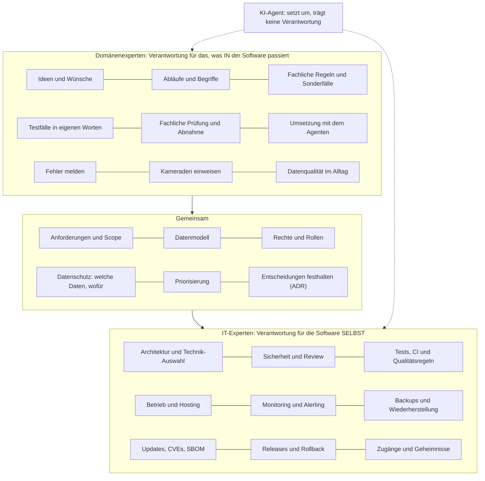

# Geteilte Verantwortung

Große Cloud-Anbieter erklären mit einem "Modell der geteilten Verantwortung", wer wofür zuständig ist: Der Anbieter ist verantwortlich für die Sicherheit _der_ Cloud, der Kunde für die Sicherheit _in_ der Cloud. Dieselbe Idee passt auf die Zusammenarbeit von Domänenexperten und IT-Experten:

- **Domänenexperten sind verantwortlich für das, was _in_ der Software passiert:** Abläufe, Begriffe, Regeln, Ideen und ob das Ergebnis im Alltag wirklich funktioniert.
- **IT-Experten sind verantwortlich für die Software _selbst_:** Architektur, Sicherheit, Betrieb und Wartung, also alles, was sie zuverlässig und sicher macht.
- **Manches verantworten beide gemeinsam**, weil es Fachwissen und IT-Wissen zugleich braucht, allen voran das Datenmodell.
- **Der KI-Agent trägt keine Verantwortung.** Er setzt um, was Menschen beauftragen und prüfen. Wer einen Pull Request einreicht oder freigibt, steht dafür ein.

## Das Modell auf einen Blick

## Wer verantwortet was

| Bereich | Domänenexperten | Gemeinsam | IT-Experten |
| --- | --- | --- | --- |
| Ideen und Wünsche | beschreiben, begründen, mit Kameraden abstimmen | priorisieren | auf Machbarkeit und Aufwand prüfen |
| Anforderungen | Abläufe, Begriffe, Sonderfälle, Beispiele | Scope festlegen, Konzept abnehmen | Rückfragen, Lücken finden |
| Datenmodell | sagen, was es in der Wirklichkeit gibt und wie es zusammenhängt | entwerfen und festhalten | Struktur, Schlüssel, Historie, Löschen, Constraints |
| Rechte und Rollen | wer im Alltag was sehen und tun muss | Rollenmodell festlegen | auf dem Server durchsetzen und prüfen |
| Datenschutz | welche Daten wirklich gebraucht werden | Zweck und Speicherdauer festlegen | technisch schützen, Zugriffe begrenzen |
| Umsetzung | mit dem Coding-Agenten bauen, kleine Pull Requests | bei großen Umbauten absprechen | Basis bauen, schwierige Teile selbst |
| Tests | erwartetes Verhalten und Sonderfälle beschreiben | Abnahmekriterien | Teststrategie, automatisierte Tests, CI |
| Review | fachlich prüfen, auf der Testumgebung ausprobieren | | Architektur, Sicherheit, Code, Freigabe |
| Betrieb | Störungen melden | Wartungsfenster abstimmen | Hosting, Monitoring, Alerting, Backups, Notfall |
| Wartung | verstehen, warum Updates wichtig sind | Budget und Zuständigkeit klären | Updates automatisieren, CVEs verfolgen, SBOM |
| Releases | neue Funktionen ankündigen und erklären | Zeitpunkt abstimmen | ausrollen, zurückrollen |
| Schulung | Kameraden einweisen | | Mitwirkende einarbeiten, Standards pflegen |

## Was daraus folgt

- **Niemand ist für alles zuständig.** Der IT-Experte muss die Abläufe in der Feuerwehr nicht im Detail kennen, und Karl muss nicht wissen, wie man einen Server härtet. Jeder braucht aber genug Verständnis für die andere Seite, um die richtigen Fragen zu stellen.
- **Die Grenzen verschieben sich mit der Zeit.** Am Anfang baut der IT-Experte viel selbst; später übernehmen Domänenexperten immer mehr Umsetzung, und der IT-Experte zieht sich auf Review, Sicherheit und Betrieb zurück ([Modul 15](15-projekt-lebenszyklus.md)). Die rechte Spalte bleibt aber immer beim IT-Experten.
- **Der KI-Agent verschiebt keine Verantwortung.** "Der Agent hat das so gebaut" ist keine Begründung. Wer den Auftrag gibt und den Pull Request einreicht, muss erklären können, was sich ändert und warum ([Modul 06](06-coding-agent.md)).
- **Was gemeinsam ist, braucht beide.** Ein Datenmodell nur aus Fachsicht ist oft unsicher oder nicht wartbar, eines nur aus IT-Sicht geht an den Abläufen vorbei ([Modul 05](05-datenmodell.md)).

## Beispiel aus dem Wachbuch

Karl möchte, dass Atemschutz-Einsatzzeiten automatisch im Nachweis der Geräteträger landen.

- **Karl** beschreibt, wie es heute läuft, welche Sonderfälle es gibt (Übung, Einsatz, abgebrochener Einsatz) und woran er erkennt, dass es stimmt. Er baut die Funktion mit dem Coding-Agenten und prüft sie auf der Testumgebung.
- **Karl und Peter gemeinsam** klären, wo die Einsatzzeit die eine Quelle der Wahrheit ist, wer die Nachweise sehen darf und was beim Stornieren eines Einsatzes passiert. Sie halten die Entscheidung als ADR fest.
- **Peter** prüft den Pull Request auf Rechte, Datenmodell und Tests, sorgt dafür, dass die Funktion überwacht und gesichert ist, und rollt sie aus.
- **Der Agent** schreibt Code und Tests nach Karls Auftrag. Verantwortlich ist er für nichts davon.
