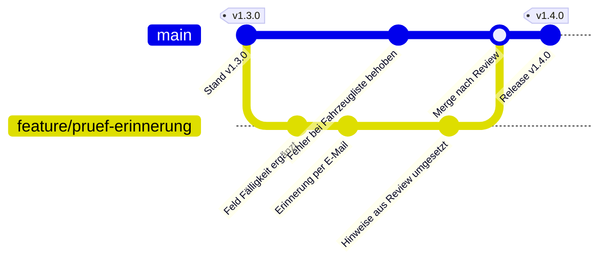

# Versionskontrolle mit Git

Stufe: **Muss ich verstehen**. Zurück zur [Übersicht](index.md).

## Das Problem: "Version 3 final final.docx"

Jeder kennt das: Ein Dokument wird von mehreren Leuten bearbeitet. Irgendwann liegen im Ordner `Dienstplan.docx`, `Dienstplan_neu.docx`, `Dienstplan_Version3_final.docx` und `Dienstplan_Version3_final_KORRIGIERT_Karl.docx`. Niemand weiß mehr, welche Datei gilt, wer was geändert hat und warum. Wenn zwei Leute gleichzeitig ändern, überschreibt einer die Arbeit des anderen.

Bei Software ist das noch schlimmer: Ein Projekt besteht aus Hunderten Dateien, die zusammenpassen müssen. Eine falsche Zeile kann alles lahmlegen.

## Die Lösung: Versionskontrolle

Eine **Versionskontrolle** ist ein System, das jede Änderung an den Dateien eines Projekts aufzeichnet: was geändert wurde, von wem, wann und mit welcher Begründung. Man kann jederzeit nachsehen, wie das Projekt gestern oder vor einem Jahr aussah, und eine Änderung gezielt zurücknehmen.

Ein Vergleich aus dem Alltag ist der Änderungsverlauf in Online-Dokumenten (z. B. in Google Docs oder Microsoft 365), wo man frühere Fassungen ansehen kann. Versionskontrolle geht weiter: Jede Änderung bekommt eine Beschreibung, mehrere Leute können parallel an getrennten Fassungen arbeiten, und diese Fassungen werden kontrolliert zusammengeführt.

Das mit Abstand verbreitetste Versionskontrollsystem heißt **Git**. Es ist kostenlos und quelloffen (Quelle: [git-scm.com](https://git-scm.com/), Stand: 2026-11-12). Fast alle Softwareprojekte nutzen es, auch das Wachbuch.

## Die wichtigsten Begriffe

| Begriff | Bedeutung | Vergleich aus dem Alltag |
| --- | --- | --- |
| **Repository** (kurz "Repo") | Der Projektordner mit allen Dateien und der kompletten Geschichte aller Änderungen | Der Aktenordner mit allen Fassungen und dem Änderungsprotokoll |
| **Commit** | Eine gespeicherte Änderung mit Beschreibung, Autor und Zeitpunkt. Ein Commit kann mehrere Dateien betreffen | Ein Eintrag im Änderungsprotokoll: "Feld für Atemschutz-Untersuchung ergänzt, Karl, 12.11." |
| **Commit-Nachricht** | Die kurze Beschreibung, was und warum geändert wurde | Die Notiz am Rand |
| **History** (Verlauf) | Die Liste aller Commits, von neu nach alt | Das Änderungsprotokoll |
| **Branch** (Zweig) | Eine eigene Arbeitsfassung, getrennt von der Hauptfassung. Man kann dort ändern, ohne die Hauptfassung zu stören | Eine Kopie des Dienstplans, an der man in Ruhe Entwürfe macht |
| **Haupt-Branch** (meist `main`) | Die gültige Fassung der Software. Hier wird nie direkt gearbeitet, nur über Pull Requests | Der unterschriebene, gültige Dienstplan |
| **Merge** (Zusammenführen) | Die Änderungen eines Branches in einen anderen übernehmen, meist in `main` | Den geprüften Entwurf in den gültigen Plan übernehmen |
| **Konflikt** | Zwei Branches haben dieselbe Stelle unterschiedlich geändert. Git kann nicht allein entscheiden, welche Fassung gilt | Zwei Leute haben dieselbe Zeile im Plan verschieden korrigiert |
| **Clone** | Eine vollständige Kopie eines Repositorys auf den eigenen Rechner holen | Den ganzen Ordner kopieren, inklusive Protokoll |
| **Push** | Eigene Commits vom eigenen Rechner auf den gemeinsamen Server hochladen | Den Entwurf ins gemeinsame Fach legen |
| **Pull** | Neue Commits der anderen vom Server holen | Nachsehen, was die anderen ins Fach gelegt haben |
| **Tag** | Ein fester Name für einen bestimmten Stand, z. B. `v1.4.0` für eine veröffentlichte Version | Ein Stempel "Fassung vom 1. Januar, gültig" |
| **Revert** | Einen früheren Commit rückgängig machen, indem ein neuer Commit die Änderung umkehrt. Die Geschichte bleibt dabei vollständig erhalten | Ein Nachtrag: "Änderung vom 12.11. wird zurückgenommen" |

Wichtig: Bei Git geht praktisch nichts verloren. Auch ein Fehler bleibt in der Geschichte sichtbar und kann nachvollzogen und zurückgenommen werden. Das macht es sicher, Dinge auszuprobieren, solange man auf einem eigenen Branch arbeitet.

Die Kehrseite: Was einmal committet wurde, bleibt in der Geschichte, auch wenn man die Datei später löscht. Ein Passwort, das versehentlich in einem Commit gelandet ist, gilt deshalb als verraten und muss geändert werden. Mehr dazu in [Modul 08](../08-sicherheit.md).

## Ein Feature-Branch am Beispiel

Karl soll für das Wachbuch eine Erinnerung für fällige Geräteprüfungen bauen. So sieht der Weg in Git aus:

Was hier passiert:

1. Der Haupt-Branch `main` steht auf Version 1.3.0.
2. Karl (bzw. sein Agent) legt einen eigenen Branch `feature/pruef-erinnerung` an und arbeitet dort in mehreren Commits.
3. Währenddessen behebt Peter auf `main` einen anderen Fehler. Karls Arbeit stört das nicht.
4. Karl öffnet einen Pull Request. Peter gibt Hinweise, Karl setzt sie in einem weiteren Commit um.
5. Nach der Freigabe wird der Branch in `main` gemergt. Später wird daraus Version 1.4.0.

## Konflikte sind normal

Ein Konflikt entsteht, wenn zwei Branches dieselbe Stelle einer Datei unterschiedlich geändert haben. Git markiert die Stelle und fragt: Welche Fassung gilt? Das ist kein Fehler, sondern Git weigert sich zu raten. Der Agent kann Konflikte oft selbst auflösen. Prüfe aber im Pull Request, ob dabei nichts von den Änderungen anderer verloren gegangen ist. Wenn du unsicher bist, frag den Architekten.

Konflikte werden seltener, wenn Branches klein und kurzlebig sind: lieber drei kleine Pull Requests in einer Woche als einer, der einen Monat liegt.

## Plattformen: GitHub und andere

Git selbst ist nur das Werkzeug, das Änderungen aufzeichnet. Damit ein Team zusammenarbeiten kann, liegt das Repository zusätzlich auf einem gemeinsamen Server. Dafür gibt es **Plattformen**, die rund um Git viele Werkzeuge anbieten.

**GitHub** ist die bekannteste Plattform, aber nur eine von vielen. Git funktioniert überall gleich; die Plattform unterscheidet sich vor allem in Bedienung, Zusatzfunktionen, Preis und darin, wo die Daten liegen.

| Plattform | Betrieb | Hinweis | Quelle |
| --- | --- | --- | --- |
| GitHub | Cloud, für Unternehmen auch selbst betrieben | Größte Plattform, viele Open-Source-Projekte, CI heißt "GitHub Actions" | [github.com](https://github.com/) |
| GitLab | Cloud oder selbst betrieben | Viele Funktionen in einem Produkt, eigene CI | [gitlab.com](https://about.gitlab.com/) |
| Gitea | selbst betrieben, auch als Cloud-Angebot | Schlank, quelloffen, läuft auf kleiner Hardware | [about.gitea.com](https://about.gitea.com/) |
| Forgejo | selbst betrieben | Gemeinschaftlich entwickelte Abspaltung von Gitea, quelloffen | [forgejo.org](https://forgejo.org/) |
| Bitbucket | Cloud | Teil der Atlassian-Produkte (z. B. Jira) | [bitbucket.org](https://bitbucket.org/) |
| Azure DevOps | Cloud oder selbst betrieben | Microsoft-Produkt, verbreitet in Unternehmen | [azure.microsoft.com](https://azure.microsoft.com/products/devops) |

Stand: 2026-11-12. Funktionen und Preise ändern sich; vor einer Entscheidung die Herstellerseiten prüfen.

**Cloud oder selbst betrieben?** Bei einem Cloud-Angebot kümmert sich der Anbieter um Server, Updates und Sicherung. Beim Selbstbetrieb läuft die Plattform auf eigenen Servern: mehr Kontrolle darüber, wo die Daten liegen, aber auch mehr Aufwand für Wartung und Sicherheit. Welche Variante ein Projekt nutzt, entscheidet der Architekt. Für dich ändert sich vor allem das Aussehen der Oberfläche, die Abläufe bleiben gleich.

Die Begriffe unterscheiden sich leicht: Was bei GitHub "Pull Request" heißt, nennt GitLab "Merge Request". Gemeint ist dasselbe.

### Was die Plattform zusätzlich zu Git bietet

| Funktion | Wozu | Mehr dazu |
| --- | --- | --- |
| **Issues** | Aufgaben, Ideen und Fehler aufschreiben und besprechen | [Modul 03](../03-konzept-und-prompt.md) |
| **Pull Requests** (Merge Requests) | Eine Änderung aus einem Branch zur Übernahme vorschlagen | [Modul 07](../07-pull-request-und-review.md) |
| **Reviews** | Änderungen Zeile für Zeile kommentieren, freigeben oder Änderungen anfordern | [Modul 07](../07-pull-request-und-review.md) |
| **CI** (bei GitHub: Actions) | Automatische Prüfungen bei jeder Änderung | [Werkzeuge](werkzeuge.md#ci-automatische-prüfungen) |
| **Rechte** | Wer darf lesen, wer darf Branches anlegen, wer darf in `main` mergen | [Modul 10](../10-standards.md) |
| **Branch-Schutz** | `main` kann nur über einen Pull Request mit Freigabe und grünen Prüfungen geändert werden | [Modul 07](../07-pull-request-und-review.md) |
| **Releases** | Veröffentlichte Versionen mit Beschreibung | [Modul 09](../09-wartung-und-releases.md) |

Der Branch-Schutz sorgt technisch dafür, dass die Regel "nichts ohne Review" auch eingehalten wird, selbst wenn jemand es eilig hat.

## Der Agent bedient Git für dich, und trotzdem musst du es verstehen

Coding-Agenten können Git selbst bedienen: Branch anlegen, committen, pushen, oft sogar den Pull Request öffnen. Du musst die Befehle also nicht auswendig können.

Verstehen musst du es trotzdem, aus drei Gründen:

1. **Du bist verantwortlich.** Der Pull Request trägt deinen Namen. Du musst sagen können, was in welchem Commit passiert ist.
2. **Agenten machen Fehler.** Sie committen manchmal zu viel (z. B. eine Datei mit Zugangsdaten), arbeiten auf dem falschen Branch oder lösen einen Konflikt falsch auf. Das erkennst du nur, wenn du weißt, wie es richtig aussieht.
3. **Das Review spricht diese Sprache.** Wenn Peter schreibt "Bitte rebase auf main und teil den Commit auf", musst du wenigstens verstehen, worum es geht, auch wenn der Agent es dann ausführt.

Gute Gewohnheiten:

- Lass den Agenten immer auf einem eigenen Branch arbeiten, nie direkt auf `main`.
- Schau dir vor dem Pull Request die Liste der geänderten Dateien an. Ist da etwas dabei, das nichts mit deiner Aufgabe zu tun hat?
- Achte auf verständliche Commit-Nachrichten. Viele Projekte nutzen dafür eine feste Form, z. B. "Conventional Commits" ([conventionalcommits.org](https://www.conventionalcommits.org/), Stand: 2026-11-12). Siehe [Modul 10](../10-standards.md).
- Wenn der Agent Befehle wie `git push --force` oder `git reset --hard` ausführen will, halte an und frage nach. Diese Befehle können Arbeit überschreiben.

## Zum Weiterlesen

- Das offizielle Git-Buch, kostenlos und auch auf Deutsch: [git-scm.com/book/de](https://git-scm.com/book/de/v2) (Stand: 2026-11-12)
- Einführungen der Plattformen, z. B. [GitHub Docs](https://docs.github.com/) oder [GitLab Docs](https://docs.gitlab.com/) (Stand: 2026-11-12)
