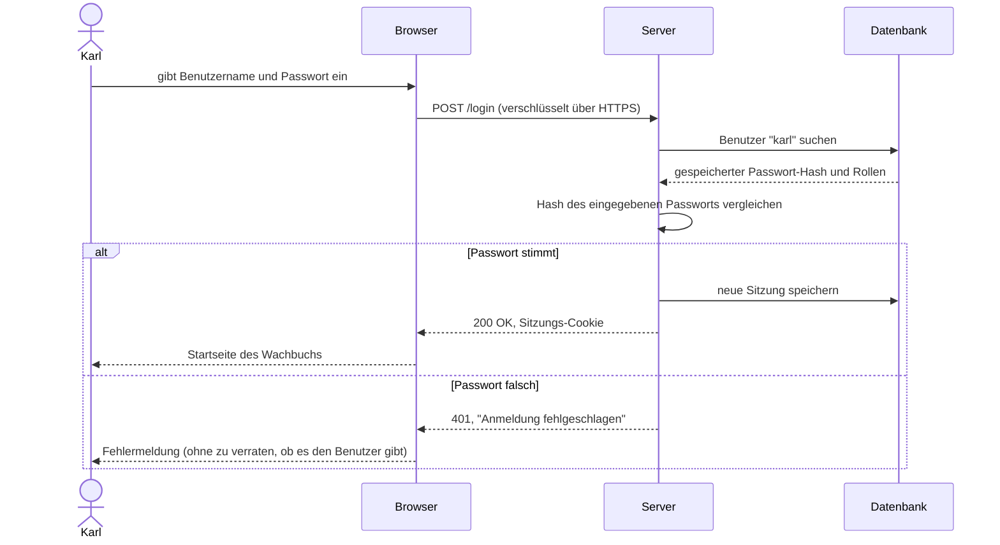
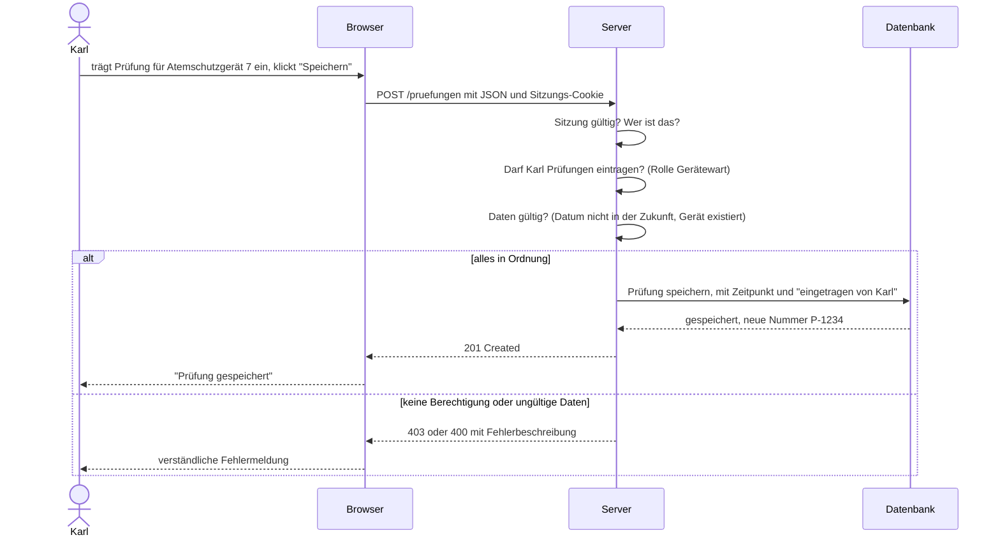

# Web und Daten: wie eine Web-Anwendung funktioniert

Stufe: **Muss ich verstehen** (Umgebungen: **Gut zu wissen**). Zurück zur [Übersicht](index.md).

Das Wachbuch ist eine Web-Anwendung. Wer daran mitbaut, sollte grob wissen, was passiert, wenn Karl im Browser auf "Speichern" klickt. Nicht, um es selbst zu programmieren, sondern um zu verstehen, wo Fehler und Sicherheitslücken entstehen können.

## Die drei Bausteine: Browser, Server, Datenbank

| Baustein | Was er tut | Vergleich |
| --- | --- | --- |
| **Browser** (Client) | Zeigt die Oberfläche an, nimmt Eingaben entgegen, schickt Anfragen an den Server. Läuft auf Karls Handy oder PC | Der Schalter, an dem man ein Formular abgibt |
| **Server** (Backend) | Ein Rechner im Internet oder im eigenen Netz. Er prüft jede Anfrage, wendet die Regeln an und spricht mit der Datenbank | Die Sachbearbeitung hinter dem Schalter |
| **Datenbank** | Speichert die Daten dauerhaft und geordnet nach dem Datenmodell | Der Aktenschrank im Hinterzimmer |

Der Browser redet nie direkt mit der Datenbank. Alles geht über den Server. Das ist wichtig, denn **nur der Server ist vertrauenswürdig**: Was im Browser läuft, kann jeder Benutzer verändern, mit wenig Wissen und frei verfügbaren Werkzeugen.

## Anfrage und Antwort: HTTP

Browser und Server unterhalten sich in einem festen Muster: Der Browser stellt eine **Anfrage** (Request), der Server schickt eine **Antwort** (Response). Die Regeln dafür heißen **HTTP** (Hypertext Transfer Protocol).

Jede Anfrage hat eine Adresse und eine Art. Die häufigsten Arten:

| Art | Bedeutung | Beispiel |
| --- | --- | --- |
| `GET` | Etwas abrufen | Liste der Fahrzeuge anzeigen |
| `POST` | Etwas Neues anlegen | Neue Geräteprüfung speichern |
| `PUT` / `PATCH` | Etwas ändern | Prüfdatum korrigieren |
| `DELETE` | Etwas löschen | Prüfung entfernen |

Jede Antwort hat einen **Statuscode**. Einige sieht man auch als Benutzer: `200` heißt "alles gut", `404` "nicht gefunden", `403` "keine Berechtigung", `500` "Fehler auf dem Server". Eine Übersicht bietet [MDN: HTTP-Statuscodes](https://developer.mozilla.org/de/docs/Web/HTTP/Status) (Stand: 2026-11-12).

## HTTPS, TLS und Zertifikate

Bei reinem HTTP geht alles im Klartext durch das Netz. Jeder, der unterwegs mitlesen kann (z. B. im offenen WLAN im Gerätehaus), sieht Passwörter und Daten.

**HTTPS** ist HTTP mit Verschlüsselung. Die Verschlüsselung heißt **TLS** (Transport Layer Security). Der Browser zeigt das mit einem Schloss-Symbol an. Damit der Browser sicher sein kann, dass er wirklich mit dem Server des Wachbuchs spricht und nicht mit einem Betrüger, legt der Server ein **Zertifikat** vor. Das ist ein digitaler Ausweis, ausgestellt von einer anerkannten Stelle. Kostenlose Zertifikate gibt es z. B. von Let's Encrypt ([letsencrypt.org](https://letsencrypt.org/), Stand: 2026-11-12). Zertifikate laufen ab und müssen regelmäßig erneuert werden, meist automatisch.

HTTPS ist für jede Web-Anwendung Pflicht, nicht nur für Online-Banking. Ohne HTTPS gibt es keine sichere Anmeldung.

## Domains und DNS

Eine **Domain** ist der Name einer Adresse im Internet, z. B. `wachbuch.example.org`. Computer finden sich aber über Nummern, die **IP-Adressen**. Das **DNS** (Domain Name System) ist das Telefonbuch des Internets: Es übersetzt den Namen in die Nummer. Wer die Domain kontrolliert, kontrolliert, wohin Benutzer geleitet werden. Deshalb gehören die Zugänge zur Domain-Verwaltung genauso geschützt wie die zum Server.

## APIs und JSON

Eine **API** (Application Programming Interface, Programmierschnittstelle) ist eine Tür in einer Software, durch die andere Programme Daten abfragen oder ändern können. Moderne Web-Anwendungen bestehen oft aus einer Oberfläche im Browser, die über eine API mit dem Server spricht. Auch andere Programme können eine API nutzen, z. B. eine Alarmierungssoftware, die Einsätze ins Wachbuch meldet.

Die Daten gehen dabei meist im Format **JSON** hin und her. Das sieht so aus:

```json
{
  "geraet": "Atemschutzgerät 7",
  "pruefart": "Jahresprüfung",
  "datum": "2026-11-12",
  "ergebnis": "bestanden"
}
```

Mehr zum Lesen von JSON in [Werkzeuge](werkzeuge.md#yaml-und-json).

Jede API ist eine Tür nach außen. Sie braucht dieselbe Anmeldung und Rechteprüfung wie die Oberfläche. Eine API, die "nur intern" gedacht war und ohne Prüfung erreichbar ist, ist eine der häufigsten Sicherheitslücken.

## Anmeldung, Sitzung und Rechte

### Anmelden und angemeldet bleiben

HTTP selbst hat kein Gedächtnis: Jede Anfrage steht für sich. Damit Karl nicht bei jedem Klick sein Passwort eingeben muss, gibt es **Sitzungen** (Sessions). Nach der Anmeldung bekommt der Browser ein zufälliges, schwer zu erratendes Kennzeichen, meist in einem **Cookie** (eine kleine Datei, die der Browser speichert und bei jeder Anfrage mitschickt). Der Server erkennt Karl daran wieder.

Wer dieses Kennzeichen stiehlt, ist für den Server Karl. Deshalb: nur über HTTPS, mit Ablaufzeit, und beim Abmelden ungültig machen.

### Passwörter werden nie im Klartext gespeichert

Der Server speichert nicht das Passwort selbst, sondern einen **Hash**. Ein Hash ist wie ein Fingerabdruck: Aus dem Passwort lässt sich der Fingerabdruck berechnen, aber aus dem Fingerabdruck nicht das Passwort. Bei der Anmeldung berechnet der Server den Fingerabdruck des eingegebenen Passworts und vergleicht ihn mit dem gespeicherten.

Wird die Datenbank gestohlen, haben die Angreifer nur Fingerabdrücke, keine Passwörter. Dafür gibt es spezielle, absichtlich langsame Verfahren wie Argon2 oder bcrypt; einfache Verfahren wie MD5 oder SHA-1 sind dafür nicht geeignet ([OWASP Password Storage Cheat Sheet](https://cheatsheetseries.owasp.org/cheatsheets/Password_Storage_Cheat_Sheet.html), Stand: 2026-11-12). Noch besser ist oft, die Anmeldung gar nicht selbst zu bauen, sondern einen bewährten Anmeldedienst oder Baustein zu nutzen. Das entscheidet der Architekt.

### Ein Login im Wachbuch



### Rechte: wer darf was?

Angemeldet sein heißt noch nicht, alles zu dürfen. **Authentifizierung** klärt: Wer bist du? **Autorisierung** klärt: Was darfst du? Im Wachbuch darf z. B. der Gerätewart alle Prüfungen sehen und eintragen, ein normales Mitglied nur die eigenen Qualifikationen, und Untersuchungsdaten zum Atemschutz sieht nur ein sehr kleiner Kreis.

Die Rechteprüfung muss **bei jeder Anfrage auf dem Server** passieren. Einen Knopf im Browser auszublenden, reicht nicht: Wer die Adresse kennt, kann die Anfrage trotzdem schicken.

### Einen Datensatz speichern



Man sieht: Der Server prüft dreimal, bevor er etwas speichert. Fehlt eine dieser Prüfungen, ist das eine Lücke. Genau danach schaut Sabine im Review.

## Wo die Daten liegen

Die Daten des Wachbuchs liegen in einer **Datenbank** auf dem Server oder bei einem Cloud-Anbieter. Verbreitet sind z. B. PostgreSQL, MySQL/MariaDB oder für kleine Anwendungen SQLite. Wie die Daten darin geordnet sind, legt das **Datenmodell** fest: welche Tabellen es gibt, welche Felder und wie sie zusammenhängen. Ausführlich in [Modul 05](../05-datenmodell.md).

Fragen, die du dir bei jeder neuen Idee stellen solltest:

- Welche neuen Daten werden gespeichert? Sind es **personenbezogene Daten** (alles, was sich einer Person zuordnen lässt)?
- Sind es **besonders sensible Daten**, z. B. Gesundheitsdaten wie die Atemschutz-Tauglichkeit? Dafür gelten nach der DSGVO strengere Regeln (Art. 9 DSGVO, [dsgvo-gesetz.de/art-9-dsgvo](https://dsgvo-gesetz.de/art-9-dsgvo/), Stand: 2026-11-12).
- Wer darf sie sehen, wer ändern, wer löschen?
- Wie lange werden sie aufbewahrt, und wann gelöscht?
- Wo steht der Server? Bei Cloud-Diensten außerhalb der EU sind zusätzliche Datenschutzfragen zu klären.
- Landen die Daten auch an Orten, an die man nicht denkt: in Protokolldateien (Logs), in E-Mails, in Fehlermeldungen, in Exporten?

## Backups

Ein **Backup** ist eine Sicherungskopie der Daten. Ohne Backup sind die Daten nach einem Festplattenschaden, einem Fehler in einem Update oder einem Angriff mit Erpressungssoftware weg.

Ein gutes Backup:

- läuft automatisch und regelmäßig,
- liegt an einem anderen Ort als die Originaldaten,
- ist verschlüsselt, weil es dieselben sensiblen Daten enthält,
- wird regelmäßig **zurückgespielt und getestet**. Ein Backup, das man nie wiederhergestellt hat, ist nur eine Hoffnung.

Backups richtet der Architekt bzw. der Betrieb ein. Als Domänenexperte solltest du wissen, dass es sie gibt, und bei Änderungen am Datenmodell fragen: Passt das Backup noch?

## Umgebungen: Entwicklung, Test, Produktion

Eine Software läuft meist in mehreren getrennten **Umgebungen**:

| Umgebung | Wofür | Daten |
| --- | --- | --- |
| **Entwicklung** (dev) | Hier probiert der Agent oder Entwickler aus, oft auf dem eigenen Rechner | erfundene Testdaten |
| **Test** oder **Staging** | Eine Kopie der echten Umgebung, um Änderungen vor der Freigabe auszuprobieren | erfundene oder sorgfältig anonymisierte Daten |
| **Produktion** (prod) | Die echte Software, die die Wehr täglich nutzt | echte Daten |

Regeln, die daraus folgen:

- Ausprobieren nie in Produktion.
- Keine echten Daten in Entwicklung oder Test, und erst recht nicht in Prompts für KI-Werkzeuge. Für Testdaten erfindet man Mitglieder wie "Max Mustermann".
- Zugangsdaten sind je Umgebung verschieden. Die Zugänge zur Produktion haben nur wenige.

## Warum das alles für die Sicherheit zählt

Fast jede Sicherheitslücke in Web-Anwendungen hat mit einem der Punkte auf dieser Seite zu tun: fehlende Rechteprüfung auf dem Server, ungeschützte API, schlecht gespeicherte Passwörter, gestohlene Sitzungen, sensible Daten in Logs, echte Daten in der Testumgebung, fehlende Backups. Eine bekannte Liste der häufigsten Probleme ist die OWASP Top 10 ([owasp.org/Top10](https://owasp.org/Top10/), Stand: 2026-11-12).

Du musst diese Lücken nicht selbst finden können. Du musst aber erkennen, wann deine Idee einen dieser Bereiche berührt, und es dann im Konzept und im Pull Request sagen. Ausführlich in [Modul 08: Sicherheit](../08-sicherheit.md).
