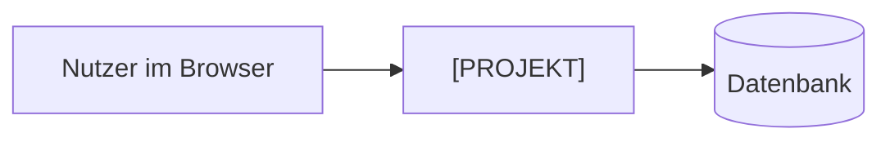

# Architektur

<!-- Eine schlanke Gliederung nach arc42 (https://arc42.org, Stand: 2026-11-12). Jeder Abschnitt darf kurz sein, ein paar Sätze oder ein Diagramm reichen. Lieber knapp und aktuell als ausführlich und veraltet. Begründungen stehen in den ADRs, hier wird nur verlinkt. -->

## 1. Ziele und Rahmenbedingungen

<!-- Wofür gibt es die Software, welche Qualitätsziele sind am wichtigsten (z. B. Datenschutz, Bedienbarkeit am Handy, einfacher Betrieb)? Welche Vorgaben gibt es (Budget, Hosting, Wissen im Team)? -->

## 2. Kontext

<!-- Wer und was spricht mit der Software? Nutzer und Rollen, andere Systeme, externe Dienste. Ein Diagramm hilft. -->

## 3. Lösungsstrategie

<!-- Die wichtigsten Grundentscheidungen in Stichpunkten, jeweils mit Link auf den ADR: Programmiersprache, Framework, Datenbank, Anmeldung, Hosting. -->

## 4. Bausteine

<!-- Aus welchen Teilen besteht die Software (z. B. Oberfläche, Server, Datenbank, Hintergrundaufgaben) und was macht jeder Teil? Wo liegen sie im Repository? -->

## 5. Abläufe zur Laufzeit

<!-- Zwei, drei wichtige Abläufe Schritt für Schritt, z. B. Anmeldung oder "Prüfung eintragen". -->

## 6. Verteilung und Betrieb

<!-- Wo läuft was? Umgebungen, Server, Container. Details auf der Seite Betrieb. -->

## 7. Querschnittsthemen

<!-- Regeln, die überall gelten: Rechteprüfung auf dem Server, Protokollierung ohne Personendaten, Fehlerbehandlung, Sprache der Oberfläche. -->

## 8. Risiken und technische Schulden

<!-- Was ist bekannt wackelig? Was muss irgendwann aufgeräumt werden? Mit Issue-Verweis. -->
