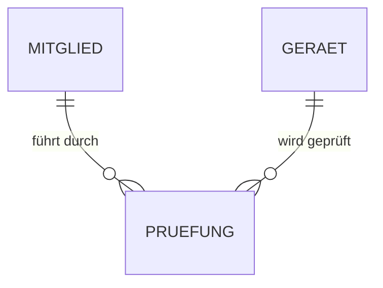

# Datenmodell

<!-- Das Datenmodell ist das Fundament. Änderungen daran brauchen einen ADR und das Review des Maintainers. Diese Seite beschreibt die Dinge, die gespeichert werden, in Fachsprache, nicht als Datenbank-Code. -->

## Überblick

<!-- Die wichtigsten Dinge und wie sie zusammenhängen, z. B. als Mermaid-Diagramm. -->

## Dinge und ihre Felder

<!-- Pro Ding eine Tabelle. Spalte "Schutzbedarf": normal, personenbezogen, besonders sensibel (z. B. Gesundheitsdaten). -->

### <Name, z. B. Gerät>

| Feld | Bedeutung | Pflicht | Schutzbedarf |
| --- | --- | --- | --- |
| <Bezeichnung> | <...> | ja | normal |

## Regeln

<!-- Fachliche Regeln, die überall gelten, mit ADR-Verweis. Beispiel: "Fachdaten werden nicht gelöscht, sondern ausgeblendet." -->

## Personenbezogene Daten

<!-- Welche Felder sind personenbezogen oder besonders sensibel, wer darf sie sehen, wie lange werden sie aufbewahrt, wann gelöscht? -->

## Begriffe

<!-- Kleines Glossar: Was genau ist ein "Gerät", eine "Prüfung", eine "Frist"? So reden alle über dasselbe. -->
