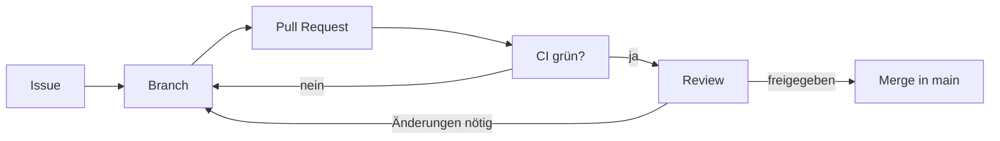

# Mitarbeit

<!-- Kurzfassung des Arbeitsablaufs. Die ausführliche Erklärung steht in der Schulung, [SCHULUNG-URL] durch deren Adresse ersetzen. -->

Jeder kann mitwirken, auch ohne Programmierkenntnisse. Die Arbeitsweise ist in einer eigenen Schulung erklärt: [SCHULUNG-URL](https://example.org/schulung/).

## Stufen der Mitarbeit

| Stufe | Was du tust | Wie |
| --- | --- | --- |
| Melden | Fehler, Wünsche, Antworten auf offene Fragen | "New issue" im Repository, Formular wählen |
| Prüfen | Neue Funktionen in der Test-Umgebung fachlich ausprobieren | Link im Pull Request |
| Bauen | Funktionen mit einem Coding-Agenten umsetzen | Issue, Branch, Pull Request, siehe [Entwicklung](../entwicklung/index.md) |

## Der Ablauf einer Änderung

1. Jede Änderung beginnt mit einem Issue.
2. Gebaut wird auf einem eigenen Branch, nie direkt auf `main`.
3. Der Pull Request folgt der Vorlage und verlinkt das Issue.
4. Die CI muss grün sein.
5. Der Maintainer gibt frei, bei Sicherheitsbezug auch Security.

## Regeln

- Keine persönlichen Daten in Issues, Pull Requests, Tests oder Screenshots.
- Sicherheitslücken nie öffentlich melden, sondern wie in `SECURITY.md` beschrieben.
- Wichtige Entscheidungen werden als [ADR](../adr/index.md) festgehalten.
- Wer mit einem Agenten arbeitet, beachtet `AGENTS.md` im Repository.

## Mehr dazu in der Schulung

<!-- Links auf die passenden Kapitel der Schulung, z. B. Rollen und Ablauf, Pull Request und Review, Mitwirken ohne Code. -->

- Rollen und Arbeitsablauf
- Pull Request und Review
- Mitwirken ohne Code
